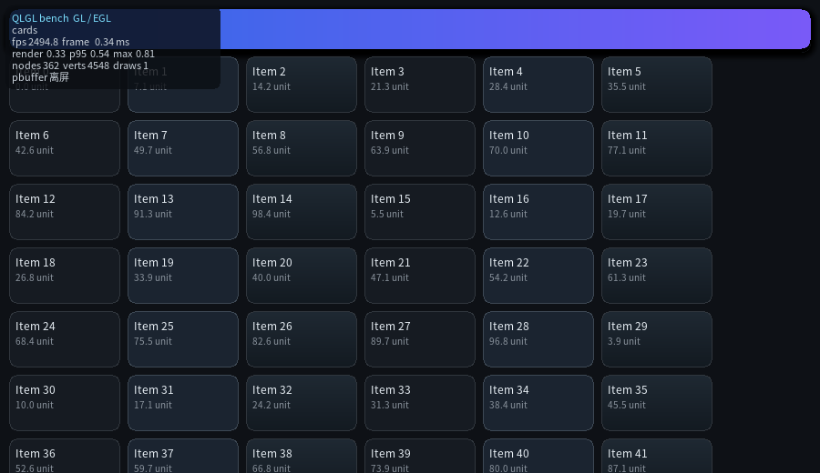

# QLGL benchmark

**一个程序、两个后端、多个维度。**

```bash
./build/benchmark/bench --list
./build/benchmark/bench                       # GL（有的话）+ 全部维度
./build/benchmark/bench --backend cpu         # 换 CPU 光栅，同一套场景
./build/benchmark/bench --unlock-fps          # 解除刷新率上限，看真实吞吐
```



左上角实时显示：维度名、帧率、整帧耗时、绘制提交耗时、p95、max、节点数、顶点数、draw call。

## 为什么要分维度

一个场景测不出全部。**填充率、文本排版、动画求值、增量重绘、布局重排是五条不同的路径**，
混在一个界面里只能得到"整体还行"，得不到"哪条路径变慢了"。所以每个维度只压一条路径，
跑完一个换下一个，最后出一张汇总表 —— 本机实测（800×480，离屏，全速）：

| 维度 | CPU | GL | 测什么 |
|---|---|---|---|
| `cards` | 2.40 ms | 0.34 ms | 填充率：圆角/边框/渐变/阴影 + 文本 |
| `text` | 2.45 ms | 0.85 ms | 文本排版：自动折行 + 字形缓存 |
| `shapes` | 2.72 ms | 0.10 ms | 几何：SDF 圆角、阴影、渐变、圆形遮罩 |
| `anim` | 1.17 ms | 0.09 ms | 动画求值 + 脏区：几十个元素同时跑关键帧 |
| `move` | 0.85 ms | 0.08 ms | 元素上下左右运动：分散的脏区 + transform |
| `scroll` | 2.19 ms | 0.19 ms | 滚动 = 重排整棵树 + 裁剪（render 只占 1.48 / 0.19） |
| `form` | 1.57 ms | 0.15 ms | 控件路径：input/select/textarea/progress/button |
| `dirty` | 1.23 ms | 0.07 ms | 增量重绘：全屏静止、只有一个小块在动 |

几个能直接读出结论的地方：

- **CPU 上 `text` 和 `cards` 一样贵**：2.4 ms 里相当一部分是字形光栅化，不是填充；
- **`scroll` 的 `render` 只占 1.48 / 2.19 ms**：剩下 0.7 ms 是 `ql_ui_scroll_by()`
  内部的**整树重排** —— 这条路径以后要优化就优化重排，别去优化绘制；
- **GL 上 `shapes` 比 `cards` 快 3 倍**：SDF 圆角/阴影在 GPU 上解析计算，
  CPU 要逐像素算 —— 这就是"GPU 后端值不值"的量化答案。

## 两个轴

| 轴 | 取值 | 说明 |
|---|---|---|
| 后端 | `--backend cpu` / `gl` | 同一场景、同一尺寸，只换绘制后端 |
| 重绘策略 | `--mode full` / `dirty` | 整屏重画（测吞吐）vs 只画脏区（测增量） |

`--mode dirty` 最能体现架构价值。同一台机器、CPU 后端：

| 维度 | full | dirty | 倍数 |
|---|---|---|---|
| `cards` | 2.40 ms | 0.46 ms | **5.2×** |
| `text` | 2.45 ms | 0.38 ms | **6.4×** |
| `scroll` | 2.19 ms | 2.30 ms | 1.0×（滚动 = 整树重排，全屏都脏） |

最后一行不是 bug，是**结论**：静态界面靠脏区能省 5-6 倍，滚动省不了 ——
因为偏移烘在布局里，每次滚动都要重排整棵树。

## 帧率可以超过屏幕刷新率

屏幕刷新率是墙：GL 窗口开 vsync 时帧率永远停在 60（或 144），那不是性能。

```
--unlock-fps      等价于 --vsync 0 --fps-cap 0，全速跑
--vsync 0|1       手动控制垂直同步（默认 1）
--fps-cap N       限到 N fps（每帧睡到 1000/N ms）
--offscreen       离屏渲染，天生没有 vsync
```

报告里有一行 **限速** 直接说明当前是哪一种，免得把"等 vsync"当成"性能不行"。

## 参数

```
--backend cpu|gl   绘制后端（默认 gl；没有 GL 时自动回落 cpu）
--scene LIST       all 或逗号分隔的维度 id（默认 all），--list 查看
--mode full|dirty  重绘策略
--scale N          维度内的份数（卡片数/元素数…），0 = 维度默认
--frames N         每个维度跑 N 帧（默认 120）
--seconds S        每个维度跑 S 秒（优先于 --frames）
--size WxH         窗口/画布尺寸（默认 800x480）
--offscreen        不开窗口（CI 友好）
--cjk              文本用中文（顺带压矢量字体字形缓存）
--no-hud           不画左上角面板
--dump PATH        每个维度导出一帧 PPM（文件名加 .<维度>.ppm 后缀）
```

## 结构

```
benchmark/
  bench.c          循环 + 后端接口（BenchBackend）+ 维度调度
  bench_scenes.h   维度表（测什么）；加维度只动这个文件
  bench_common.h   命令行 + 统计 + HUD + 结果表
```

三层互不认识：`bench.c` 只认 `k_scenes[]` 这张表，不认识具体维度；
维度只产出 `QLUIDoc`，不认识后端。

## 加一个新维度

```c
static QLUIDoc *scene_mychart_build(const BenchOpts *o, int scale) { /* HTML+CSS */ }
/* 可选：每帧要动的东西（CSS 动画之外的动作，比如滚动、改值） */
static void scene_mychart_tick(QLUIRoot *ui, uint32_t frame) { }

static const BenchScene k_scenes[] = {
    /* ... 已有条目 ... */
    { "mychart", "一句话说明这个维度压哪条路径", 40, 400,
      scene_mychart_build, scene_mychart_tick },
};
```

就这一处。HUD、统计、汇总表、命令行、`--scene all` 全部自动带上。

写维度时注意：本库**没有 inline style**，也没有"运行期改样式"的 API
（能改的只有 `ql_ui_set_text()` / `ql_ui_input_set_value()` /
`ql_ui_progress_set()` / 滚动），所以"让画面动起来"要靠 CSS `@keyframes`，
或者在 `tick` 里调那几个运行时 API。

## 与老 benchmark 的关系

`test/web/example_bench_fps.c`（分辨率扫描）和 `example_bench_ui.c`
（布局/重绘分阶段）仍然保留：它们测的是单一指标的历史趋势，
这里的 `bench` 测的是**场景级**的多维度对比，两者互补。
