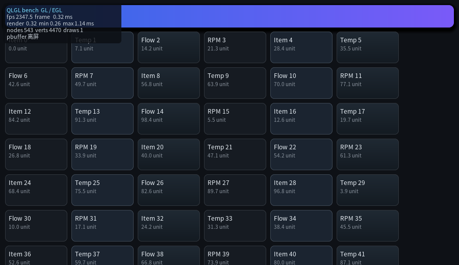

# QLGL benchmark

两个可执行文件，**同一个场景**，只换绘制后端 —— 这样"GL 比 CPU 快多少"才是可比的数字。

| 程序 | 画到哪 | 测什么 |
|---|---|---|
| `bench_cpu` | `QLCanvas`（CPU 光栅）→ X11 / Wayland 窗口，或内存显示 | 光栅吞吐：填充、圆角、渐变、阴影、字形 |
| `bench_gl` | `QLDraw2D`（EGL / GLES3）→ GL 窗口，或 pbuffer 离屏 | 同上，但走 GPU；顺带算顶点数与 draw call |



左上角那块面板实时显示：帧率、整帧耗时、绘制提交耗时、min/max、节点数、顶点数、draw call。

## 跑起来

```bash
cmake -S . -B build && cmake --build build -j --target bench_cpu bench_gl

./build/benchmark/bench_cpu                       # 开窗口，实时帧率
./build/benchmark/bench_gl                        # 同上，GPU
./build/benchmark/bench_gl  --vsync 0             # 不限帧，测吞吐上限
./build/benchmark/bench_cpu --offscreen --frames 300   # 不开窗口，只打数字（CI）
./build/benchmark/bench_gl  --size 1280x720 --cards 200
./build/benchmark/bench_cpu --cjk                  # 文本换中文，压字形缓存
```

不让构建：`cmake -S . -B build -DQLGL_BUILD_BENCHMARK=OFF`

## 场景

参考 LVGL 的 benchmark：**固定场景、每帧整屏重画**。场景由 `bench_build_scene()` 生成：

- 一块 `linear-gradient` + `box-shadow` 的 hero 面板（渐变与 SDF 阴影）；
- N 张卡片（默认 120），每张：1px 边框 + 8px 圆角 + 背景色/渐变 + 两行文本；
- 一根 `@keyframes` 滑动的进度条 —— 保证每帧画面真的在变。

**整屏重画是刻意的**：它测的是填充率与文本绘制这些"贵"的路径。
局部重绘能力另外由 `test_gl_dirty` 守着（脏区重绘 vs 整屏重绘逐像素相同），
动画的脏区行为见 `example/05_animation.c`。

## 三个数字要分清

| HUD 字段 | 含义 |
|---|---|
| `frame` | 整帧墙钟：含 `eglSwapBuffers` / `XPutImage`，也含 `--fps-cap` 的睡眠 |
| `render` | "绘制提交"的净耗时（清屏→画完→推送），不含等待 |
| `fps` | 滑动窗口（120 帧）平均帧率；只看最近一帧的倒数是会乱跳的 |

开了 vsync，`frame` 就是 16.7ms、`fps` 就是 60 —— **那不是性能是等待**，
看 `render` 才知道还剩多少余量；要测吞吐就 `--vsync 0`。

## 本机参考数字（800×480，120 张卡片 / 363 节点）

| 后端 | 整帧 | 吞吐 |
|---|---|---|
| `bench_cpu` | 2.2–2.4 ms | ≈ 410 fps |
| `bench_gl`（离屏） | 0.30–0.36 ms | ≈ 2900 fps |

数字只用来**看相对量和回归**，换机器必然不一样。

## 新增一个后端怎么办

`bench_common.h` 里的场景、计时、HUD 都不碰后端。新后端只需要：

1. 把场景画到一个 `QLDraw2D` 上；
2. 每帧 `bench_fps_add(&fps, 整帧毫秒)`；
3. 有 HUD 就在画完之后调一次 `bench_hud_draw(d2d, css_w, css_h, &fps, &info)`，
   退出前调 `bench_report()`。

`info.backend` / `info.detail` 写后端名与运行方式，`draws == 0` 时 HUD 会显示
`cpu raster` 而不是一排 0。
