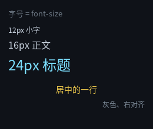
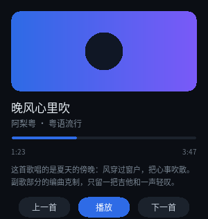

# 文本

界面里最多的东西大概就是文字。这一章讲清 QLGL 文本的四条规则，
以及为什么它和浏览器不太一样。



完整程序：`example/02_text.c`

```c
static const char *k_html =
    "<div id=\"root\">"
    "  <div class=\"h1\">字号 = font-size</div>"
    "  <div class=\"s12\">12px 小字</div>"
    "  <div class=\"s16\">16px 正文</div>"
    "  <div class=\"s24\">24px 标题</div>"
    "  <div class=\"c\">居中的一行</div>"
    "  <div class=\"dim\">灰色、右对齐</div>"
    "</div>";

static const char *k_css =
    "#root { width: 260px; height: 220px; background-color: #0F1218; }"
    ".h1  { margin: 12px 0 8px 14px; font-size: 13px; color: #6C7783; }"
    ".s12 { margin: 2px 14px; font-size: 12px; color: #C8D2DE; }"
    ".s16 { margin: 2px 14px; font-size: 16px; color: #C8D2DE; }"
    ".s24 { margin: 2px 14px; font-size: 24px; color: #7CE0FF; }"
    ".c   { margin: 12px 14px 4px 14px; font-size: 14px; color: #E6C34A;"
    "       text-align: center; }"
    ".dim { margin: 2px 14px; font-size: 12px; color: #7A8794;"
    "       text-align: right; }";
```

## 规则一：一个元素 = 一整段文本

`<div>` 里的文字是**这个元素的文本**，不是子节点。所以：

```html
<div class="a">短文本</div>          <!-- ✅ 一个元素一段文本 -->
<p>Hello <b>world</b>!</p>            <!-- ✅ 编译期拆成三个元素 -->
```

第二种写法看着像"混合内容"，其实在**编译期**就被拆开了：

```html
<p><span>Hello </span><b>world</b><span>!</span></p>
```

文本段变成匿名的 `<span>`。这样做的好处是运行期数据模型里根本没有"文本节点"
这个东西 —— 元素树就是全部。代价是运行期不能往"文本中"插入元素（只能改整段文本）。

## 规则二：字号来自 `font-size`，颜色来自 `color`

两者都会被**继承**：

```css
.card { font-size: 14px; color: #C8D2DE; }
.card .title { font-size: 18px; }    /* 颜色自动继承 14px 那层的 */
```

`doc->font_sizes[]` 是**去重后的字号表**，每个节点的 `font_id` 是它的下标。
一个页面用几种字号就只建几套字形缓存，不会每个节点一份。

调一下程序就能看到：

```
字号表： 16px 13px 12px 24px 14px
```

（16px 排第一，因为 `@root` 没写 `font-size`，用了默认值。）

> **注意**：`font-size` 是**设备无关的 CSS 像素**。高 DPI 下由绘制后端乘缩放 ——
> 布局代码永远不需要关心 DPR。

## 规则三：`text-align` 控制水平对齐

只有三个值：`left` / `center` / `right`。对齐是在**元素的内容盒**里做的
（`content_box` = 边框盒减掉 `padding` 与 `border`）。

## 规则三·补：`line-height` 控制竖直位置（按钮里"字对不齐"的答案）

这是新手最常见的一个坑：写了个按钮，加了 `text-align: center`，字还是贴在顶上。

```css
.btn { width: 56px; height: 26px; text-align: center; }   /* ❌ 字贴顶 */
.btn { width: 56px; height: 26px; text-align: center;
       line-height: 26px; }                               /* ✅ 正中 */
```

**这不是 bug，浏览器里也一样**：块布局里文字从内容盒顶部开始排，
第一行占一个行盒（行盒高 = `line-height`）。想让单行字垂直居中，
就把 `line-height` 设成和 `height` 一样 —— 多出来的空间上下各分一半。

`line-height` 接受三种写法：

| 写法 | 含义 |
|---|---|
| `normal` | 用字体自己的行高（ascent + descent），也就是不给值的行为 |
| `24px` | 固定像素值。**垂直居中就靠它**：和 `height` 相等 |
| `1.5` | 无单位 = 当前 `font-size` 的倍数（`1.5 × 16px = 24px`） |

它和 `font-size` / `color` / `text-align` 一样**会被继承**：
在容器上写一次，里面的文字都吃这个行高。

```css
.card { font-size: 13px; line-height: 20px; }   /* 卡片里所有文字统一行高 */
```

> 一件事要清楚：`line-height` 只影响**文字在行盒里的竖直位置**和行间距，
> 不改变行盒的数量。所以多行文本用它调行距，单行文本用它做垂直居中。
> 想要"文字在任意高度的盒子里居中而不用算像素"，当前没有 `flex` 那套
> 匿名文本盒，还是得让 `line-height` 等于盒高。

## 规则四：默认不折行，`white-space: normal` 才折

**这是本库与浏览器唯一有意为之的差异**：浏览器默认就折行（`white-space: normal`），
本库默认 `nowrap` —— 一段文本就是一行，超长就溢出（被父级 `overflow: hidden` 裁掉）。

```css
.card { width: 268px; white-space: nowrap; }   /* 默认：一行，超长溢出 */
.card { width: 268px; white-space: normal; }   /* 按宽度折行 */
```

为什么默认反过来：v0 的文本模型就是"一段文本一行"，大量已有界面（包括一整套
逐像素基准图）都建立在这个前提上。改成浏览器默认会让那些页面在你没改任何东西的
情况下重新排版。所以折行要**显式打开**：一行 CSS 换一个明确的语义。

打开之后长度就自动长了 —— 节点高度 = 行数 × `line-height`，布局与绘制用的是
**同一份断行结果**（`ql_text_wrap()`），所以不会出现"布局按一行算、画了三行"。

断行规则（`ql_text_wrap()`，PC/MCU 同一份）：

| 情况 | 行为 |
|---|---|
| 空格 | 在空格之后断，行首行尾的连续空白丢弃 |
| 中文 | 汉字之间随处可断（和浏览器一致） |
| 超长单词 | 一行放不下一个词时**硬断**，不做连字符 |
| `\n` | 永远强制断行，与折行叠加 |

```css
/* 一个真实的例子：播放器里的简介 */
.desc { width: 268px; font-size: 11px; line-height: 18px;
        color: #7A8794; white-space: normal; }
```



`line-height` 在这里同时干两件事：单行居中（上一节）和多行行距（这一节）。
`white-space` 也**会被继承**，所以可以在容器上写一次。

> 还不支持的：`pre` / `pre-wrap` / `break-spaces`（要保留空白与制表符语义，
> 本库不做），以及 `text-overflow: ellipsis`（"太长就省略号"）。写了会**报错**，
> 不会静默降级。

## 运行期改文本

```c
ql_ui_set_text(ui, node, "新的内容");
```

这一条是**运行期唯一允许改的东西**（结构在编译期固定）。它会顺带把节点标脏，
主循环用 `ql_ui_consume_dirty()` 拿到区域后局部重绘。

下一章的例子里会用到它。

---

上一章：[基础知识](01_basics.html) ｜ 下一章：[布局](03_layout.html)
