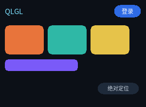

# 布局



完整程序：`example/03_layout/main.c`

这是一个"顶栏 + 三张卡 + 一条半宽色带 + 一个绝对定位徽标"的界面。
布局代码只有 CSS，没有一行 C。

## flex 是主力

QLGL 的布局内核就是 flexbox 的一个子集。日常界面用它就够：

```css
.bar {
  display: flex;            /* 这个容器按 flex 排子元素 */
  align-items: center;      /* 交叉轴（这里是纵向）居中 */
  gap: 8px;                 /* 子元素间距，不占两端 */
  height: 32px;
}
```

### `display: flex` 与 `display: block` 的区别

| | `block` | `flex` |
|---|---|---|
| 子元素怎么排 | 纵向一堆，每个占满宽度 | 按 `flex-direction` 排（默认横向） |
| 子元素能设置 `flex-grow` | 否 | 是 |
| 能用 `gap` | 否 | 是 |

### `flex-direction`

```css
.row    { display: flex; flex-direction: row; }      /* 默认，从左到右 */
.col    { display: flex; flex-direction: column; }   /* 从上到下 */
```

### `justify-content` 管主轴

主轴 = `flex-direction` 的方向。所以 `row` 时它管水平，`column` 时管垂直。

```css
.a { justify-content: flex-start; }     /* 挤在开头（默认） */
.b { justify-content: center; }         /* 居中 */
.c { justify-content: flex-end; }       /* 挤在末尾 */
.d { justify-content: space-between; }  /* 两端贴边，间距均分 */
.e { justify-content: space-around; }
.f { justify-content: space-evenly; }
```

### `align-items` 管交叉轴

```css
.a { align-items: stretch; }    /* 拉满（默认） */
.b { align-items: flex-start; }
.c { align-items: center; }
.d { align-items: flex-end; }
```

### `flex-grow`：把剩余空间按比例分

顶栏里"左 logo、右按钮"是最常见的需求。做法是中间塞一个空的伸缩块：

```html
<div class="bar">
  <div class="logo">QLGL</div>
  <div class="spacer"></div>        <!-- flex-grow: 1 -->
  <div class="btn">登录</div>
</div>
```

```css
.spacer { flex-grow: 1; }
```

`flex-grow` 是**权重**，不是百分比。两个 `flex-grow: 1` 和一个 `flex-grow: 2`
会把剩余空间分成 1:1:2。

> **一条容易踩的语义**：flex 项的 `width: auto` 是 **max-content**（内容多大就多大），
> 而不是 block 布局里的"撑满容器"。所以上面那个空的 `.spacer` 基准尺寸是 **0**，
> grow 分到的就是全部剩余空间；旁边的 `.btn` 写死 `56px` 就一直是 56px，
> 不会被挤扁。（这条以前实现错了，`test_flex_auto` 现在钉着它。）

::: tip
很多框架把这种写成一个"自动推挤"的工具类。QLGL 里就是 `flex-grow: 1`，
没有魔法。
:::

## 百分比按父容器算

```css
.half { width: 50%; }      /* 父容器 300px → 150px */
```

可以混用：`width: 80px` 的固定卡 + `width: 50%` 的伸缩带，同一个容器里也行。

## `position` 管叠加

flex 管"排队"，`position` 管"叠加"。三个值：

| 值 | 含义 |
|---|---|
| `static` | 默认，参与正常布局 |
| `relative` | 还在布局里，但可以用 `top/left` 相对自己的位置偏移；同时成为子元素绝对定位的参照 |
| `absolute` | **脱离布局**，按最近的已定位祖先的 padding 盒定位 |
| `fixed` | 同 `absolute`，但参照视口 |

```css
.badge {
  position: absolute;
  left: 200px; top: 170px;      /* 相对 #root 的左上角 */
  width: 86px; height: 24px;
}
```

因为 `#root` 没写 `position`，`absolute` 的参照就是视口本身
（在这个程序里视口 = `#root` 的尺寸，所以看起来一样）。

> 想让徽标相对某张卡定位，就在卡上写 `position: relative`。

## 布局结果是可以直接读的

布局完成后每个节点都有 `border_box` / `content_box` / `paint_box`：

```c
ql_ui_layout(ui, 300, 220);
for (uint16_t i = 0; i < ui->node_count; i++) {
    QLRect b = ql_ui_node_rect(&ui->nodes[i]);
    printf("  #%u  %4d,%-4d %3dx%-3d\n", i, (int)b.x, (int)b.y, (int)b.w, (int)b.h);
}
```

这个程序打印出来是（编号 = 文档顺序，父在前）：

```
  #0     0,0    300x220     ← #root
  #1    10,10   280x32      ← .bar（margin 10，所以从 10,10 开始）
  #2    10,11    37x23      ← .logo，宽度由文本撑开
  #3    55,23   171x0       ← .spacer，flex-grow 吃掉了剩余空间
  #4   234,10    56x26      ← .btn，固定 56 宽，贴右边界
```

注意 `#4` 的右边界是 `234 + 56 = 290`，正好等于 `#1` 的右边界（`10 + 280`）——
这说明 grow 分配没有丢余数。

调试布局时这是最直接的办法 —— 不用猜，直接读。

## 单位只有一个

**布局、QLUI、控件层、自定义绘制，一律是 CSS 像素（整数）。**

唯一做换算的地方是绘制后端入口：`QLDraw2D` 会把 CSS px 乘上 `scale_fx`
（26.6 定点），变成设备像素。所以：

* 高 DPI 不需要动任何布局代码；
* 布局结果是确定的整数，没有浮点误差累积；
* 亚像素（`translate(0.5px)`）在**绘制期**表达，不进布局。

## 明确不支持的

写错就是编译期报错，不会"凑合"：

```
float / clear / display: table
flex-wrap: wrap-reverse       table 布局
```

布局这块**已经补齐**的（早期版本列在上面那张清单里，别再照老文档写）：

| 能力 | 备注 |
|---|---|
| `min-width` / `max-width` / `min-height` / `max-height` | px 与 `%` |
| `em` / `rem` / `vw` / `vh` / `vmin` / `vmax` | `em`/`rem` 构建期折 px |
| `calc()` / `min()` / `max()` / `clamp()` | 编成后缀字节码，布局期求值 |
| `@media (min-width/max-width)` | 只有宽度断点 |
| `order` / `align-self` / `align-content` / `flex-flow` | 多行 `align-content` 六种取值都有 |
| `position: sticky` / `absolute` / `fixed` / `z-index` | |
| `overflow: auto` 的滚动 | 覆盖式滚动条，可以用 `scrollbar-width/color` 定制 |

`float` 仍然不支持——本库没有"文字环绕"，需要并排就用 flex。

---

上一章：[文本](02_text.html) ｜ 下一章：[交互](04_interaction.html)
