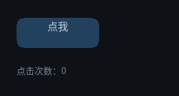

# 交互



完整程序：`example/04_interaction.c`

这一章做三件事：鼠标移上去变样、按下去下沉、点击改文本。

## 状态样式：`:hover` / `:active` / `:focus`

```css
.btn { background-color: #22415F; color: #C8D2DE;
       transition: 160ms ease-out; }

.btn:hover  { background-color: #2E6BE6; color: #FFFFFF;
              transform: translate(0px, -2px); }

.btn:active { background-color: #1B4CA8; transform: translate(0px, 1px); }
```

就这么多。**没有 C 代码**。

这里有个关键设计：`:hover` 之类的状态样式在**编译期**就被算成了"状态变体样式"，
存在 `nodes[i].style_hover` / `style_active` / `style_focus` 这三个下标里。

所以运行期切状态的开销是：

```
换一个样式指针，标脏                ← 没有选择器匹配，没有重新编译
```

三个状态同时成立时的优先级：

```
:active > :focus > :hover > 基础样式
```

## 事件怎么进来

主循环里只要**两行**：

```c
while (ql_gfx_gl_poll(gfx)) {      /* 收窗口事件 */
    ql_input_dispatch();           /* 派发：指针 → hover/active/click */
    ...绘制...
}
```

`ql_ui_attach_input(ui)` 把 `QLUIRoot` 接到输入系统上（同一时刻只有一个
`QLUIRoot`，与"单一窗口"一致）。之后 `ql_input_dispatch()` 就会：

1. 拿到指针位置 → 做命中测试（**逆变换**，所以动画中的元素也点得中）；
2. 改状态位 → 触发 `transition`；
3. 在 `pointer_up` 落在同一个节点上时 → 调点击回调。

想自己处理按键（`Esc` 关闭窗口之类），装一个 sink：

```c
static void sink(const QLInputEvent *ev, void *user)
{
    if (ev->type == QL_INPUT_KEY_DOWN && ev->key == QL_KEY_ESCAPE) {
        ql_gfx_gl_close(gfx);
        return;
    }
    ql_ui_input_event((QLUIRoot *)user, ev);   /* 其余交给界面 */
}
ql_input_set_sink(sink, ui);
```

## 点击回调

```c
static void on_click(QLUIRoot *ui, QLUINodeRT *node, void *user)
{
    if (node->src->tag != QL_UI_TAG_DIV)
        return;                     /* 只看自己关心的节点 */
    s_clicks++;
    char buf[64];
    snprintf(buf, sizeof(buf), "点击次数：%d", s_clicks);
    ql_ui_set_text(ui, s_log, buf);
}

ql_ui_set_click_cb(ui, on_click, NULL);
```

一条回调管全树，靠 `node` 区分是哪个。为什么不给每个节点单独注册？
因为结构是编译期固定的 —— 用一个 `switch (node - ui->nodes)` 或者查
`node->src->id` 就够了，不用为每个节点分配回调槽。

节点顺序就是**文档顺序**（深度优先、父在前），所以 `&ui->nodes[2]` 就是
HTML 里第 3 个元素。也可以用 `ql_ui_find_by_tag(ui, QL_UI_TAG_DIV, 1)`
按标签找。

## 没有窗口时怎么办

交互链路可以用合成事件走一遍，写测试时非常有用：

```c
ql_ui_pointer_move(ui, 84, 48);    /* 移进去 → :hover */
ql_ui_pointer_down(ui, 84, 48);    /* 按下去 → :active */
ql_ui_pointer_up(ui, 84, 48);      /* 松开  → click 回调 */
```

这个例程在没有参数的运行时会自己合成一次点击，输出：

```
合成一次点击（窗口模式请用鼠标点按钮）
点击次数：1
```

## transition 是"状态变了就渐变过去"

注意上面 CSS 里的 `transition: 160ms ease-out`。它的作用是：状态变化时，
颜色/位移在 160ms 内**插值**过去，而不是瞬间跳。

三条行为：

* **不进布局** —— 过渡只改绘制期属性（颜色、alpha、位移、缩放、圆角、遮罩），
  所以过渡期间**零重排**；
* **打断从当前值重基** —— 快速移入移出不会跳变；
* **只重绘脏区** —— 每帧只重画受影响的那几块。

下一章专讲动画。

## 焦点与键盘

```c
ql_ui_set_focus_node(ui, node);    /* 驱动 :focus 样式 */
ql_ui_focus_node(ui);              /* 查当前焦点 */
```

Tab 键的焦点链**没有内建** —— 键盘导航是产品的决定，不是库的决定。
需要时在 sink 里自己管（换焦点就是一次 `ql_ui_set_focus_node`）。

---

上一章：[布局](03_layout.html) ｜ 下一章：[动画](05_animation.html)
