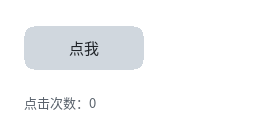

# 交互



完整程序：`example/04_interaction/main.c`

这一章做三件事：鼠标移上去变样、按下去下沉、点击改文本。

## 状态样式：`:hover` / `:active` / `:focus`

```css
.btn { background-color: #22415F; color: #C8D2DE;
       transition: 160ms ease-out; }

.btn:hover  { background-color: #2E6BE6; color: #FFFFFF;
              transform: translate(0px, -2px); }

.btn:active { background-color: #1B4CA8; transform: translate(0px, 1px); }
```

就这么多。**没有 C 代码**。

这里有个关键设计：`:hover` 之类的状态样式在**编译期**就被算成了"状态变体样式"，
存在 `nodes[i].style_hover` / `style_active` / `style_focus` 这三个下标里。

所以运行期切状态的开销是：

```
换一个样式指针，标脏                ← 没有选择器匹配，没有重新编译
```

三个状态同时成立时的优先级：

```
:active > :focus > :hover > 基础样式
```

## 事件怎么进来

主循环里只要**两行**：

```c
while (ql_gfx_gl_poll(gfx)) {      /* 收窗口事件 */
    ql_input_dispatch();           /* 派发：指针 → hover/active/click */
    ...绘制...
}
```

`ql_ui_attach_input(ui)` 把 `QLUIRoot` 接到输入系统上（同一时刻只有一个
`QLUIRoot`，与"单一窗口"一致）。

> ⚠️ **漏了这一句的表现非常迷惑**：窗口能开、滚动条能滚（那是主循环里
> `ql_input_dispatch()` 之外的机制），但**点不动、hover 不亮、也打不了字** ——
> 事件在派发那一步因为没有事件汇被**静默丢掉**。
> 早期版本的例程就漏过这一句，`test/input/test_ui_attach.c` 现在专门守它。

之后 `ql_input_dispatch()` 就会：

1. 拿到指针位置 → 做命中测试（**逆变换**，所以动画中的元素也点得中）；
2. 改状态位 → 触发 `transition`；
3. 在 `pointer_up` 落在同一个节点上时 → 调点击回调。

想自己处理按键（`Esc` 关闭窗口之类），装一个 sink：

```c
static void sink(const QLInputEvent *ev, void *user)
{
    if (ev->type == QL_INPUT_KEY_DOWN && ev->key == QL_KEY_ESCAPE) {
        ql_gfx_gl_close(gfx);
        return;
    }
    ql_ui_input_event((QLUIRoot *)user, ev);   /* 其余交给界面 */
}
ql_input_set_sink(sink, ui);
```

## 按 id / class 找节点

```c
QLUINodeRT *btn = ql_ui_find_by_id(ui, "btn");
QLUINodeRT *log = ql_ui_find_by_id(ui, "log");

/* 第 2 个 class="item" 的节点（nth 从 0 开始） */
QLUINodeRT *item = ql_ui_find_by_class(ui, "item", 1);
```

不要再写 `&ui->nodes[2]`：前面插一个元素，下标就全变了。
`ql_ui_find_by_tag(ui, QL_UI_TAG_DIV, 1)` 仍然可用，但它按"第几个 div"
找，插删同类元素同样会漂。

## 点击回调：一个按钮一个

```c
static void on_btn_click(QLUIRoot *ui, QLUINodeRT *btn, void *user)
{
    (void)btn;
    QLUINodeRT *log = (QLUINodeRT *)user;
    s_clicks++;
    static char buf[64];
    snprintf(buf, sizeof(buf), "点击次数：%d", s_clicks);
    ql_ui_set_text(ui, log, buf);
}

QLUINodeRT *btn = ql_ui_find_by_id(ui, "btn");
QLUINodeRT *log = ql_ui_find_by_id(ui, "log");
ql_ui_set_node_click_cb(ui, btn, on_btn_click, log);   /* user 里带输出节点 */
```

- 点到按钮里的 `<span>` / 图标 / 内层 `<div>` 会**冒泡到按钮**；
- 绑定即停止：按钮回调触发后，不会再继续冒泡，也不会调全局 `click_cb`；
- `ql_ui_set_click_cb(ui, cb, user)` 仍然保留，作为**没有节点绑定时的兜底**；
- 解绑：`ql_ui_set_node_click_cb(ui, btn, NULL, NULL)`。

绑定表按需分配，默认最多 16 个（`QL_CFG_UI_CLICK_BIND_MAX`）。

## 没有窗口时怎么办

交互链路可以用合成事件走一遍，写测试时非常有用：

```c
ql_ui_pointer_move(ui, 84, 48);    /* 移进去 → :hover */
ql_ui_pointer_down(ui, 84, 48);    /* 按下去 → :active */
ql_ui_pointer_up(ui, 84, 48);      /* 松开  → click 回调 */
```

这个例程在没有参数的运行时会自己合成一次点击，输出：

```
合成一次点击（窗口模式请用鼠标点按钮）
点击次数：1
```

## transition 是"状态变了就渐变过去"

注意上面 CSS 里的 `transition: 160ms ease-out`。它的作用是：状态变化时，
颜色/位移在 160ms 内**插值**过去，而不是瞬间跳。

三条行为：

* **不进布局** —— 过渡只改绘制期属性（颜色、alpha、位移、缩放、圆角、遮罩），
  所以过渡期间**零重排**；
* **打断从当前值重基** —— 快速移入移出不会跳变；
* **只重绘脏区** —— 每帧只重画受影响的那几块。

下一章专讲动画。

## 焦点与键盘

```c
ql_ui_set_focus_node(ui, node);    /* 驱动 :focus 样式 */
ql_ui_focus_node(ui);              /* 查当前焦点 */
```

Tab 键的焦点链**没有内建** —— 键盘导航是产品的决定，不是库的决定。
需要时在 sink 里自己管（换焦点就是一次 `ql_ui_set_focus_node`）。

---

上一章：[布局](03_layout.html) ｜ 下一章：[动画](05_animation.html)
