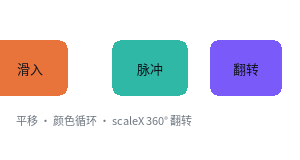

# 动画



完整程序：`example/05_animation.c`

三类动效，全部只写 CSS：

| 写法 | 触发 | 例子 |
|---|---|---|
| `transition` | 状态变化（`:hover` 之类） | 按钮变色、卡片抬起 |
| `@keyframes` | 自己一直播 / 播 N 次 | 滑入、脉冲、翻转 |
| 手动 `ql_ui_anim_tick` | 你的代码决定 | 进度条、滚动 |

## `@keyframes` 长什么样

```css
.slide { animation: slide-in 1400ms ease-out infinite; }
.pulse { animation: pulse    1400ms ease-in-out infinite; }
.flip  { animation: flip-x   1400ms ease-in-out infinite; }

@keyframes slide-in {
  from { transform: translate(-24px, 0px); }
  to   { transform: translate(0px, 0px); }
}
@keyframes pulse {
  0%   { background-color: #2FB8A6; }
  50%  { background-color: #E6C34A; }
  100% { background-color: #2FB8A6; }
}
@keyframes flip-x {
  0%   { transform: scaleX(1); }
  50%  { transform: scaleX(0); }
  100% { transform: scaleX(1); }
}
```

`animation` 的完整写法：

```
animation: <name> <duration> [ease] [delay] [iteration] [direction] [fill-mode]
```

## 关键帧在编译期就摊平了

`@keyframes` **不**在运行期解析。编译器把它变成两张静态表：

```
QLUIKeyframe[]   每一帧：时间点(千分比) + 缓动 + 通道位 + 各通道的值
QLUIAnimation[]  每一段：帧区间 + 时长 + 迭代次数 + 方向 + fill + 延迟
```

运行期求值就是一个纯函数：

```c
u = f(now - start_ms)        /* 0..1，不累加 dt */
```

**不累加 `dt`** 这点很重要：掉帧、窗口最小化、补帧都不会造成漂移，
`uint32` 回绕天然安全。

## 主循环只要一行

```c
while (running) {
    ql_input_dispatch();
    ql_ui_anim_tick(ui, ql_anim_now_ms());     /* ← 就这一行 */

    QLRect areas[16];
    int n = ql_ui_consume_dirty(ui, areas, 16);
    if (n > 0) {
        ql_gfx_gl_begin_rects(gfx, bg, areas, n);
        for (int i = 0; i < n; i++)
            ql_ui_render_rect(ui, d2d, areas[i]);
        ql_gfx_gl_end(gfx);
    }
}
```

`ql_ui_anim_tick` 的返回值是**这一帧还在动的动画数**（不是"还剩几帧"）：

* 返回 0 → 界面完全静止，**可以整帧跳过**（省电，也是 MCU 上能跑的前提）；
* 返回非 0 → 至少有一个节点被标脏。

不要用"返回值变成 0"来判断某个动画播完了 —— `infinite` 的动画永远非 0。
要那类事件用回调：

```c
ql_ui_set_anim_end_cb(ui, on_anim_end, NULL);
/* kind 是 QL_UI_ANIM_END_KEYFRAMES 或 QL_UI_ANIM_END_TRANSITION */
```

## 脏区：动画只在需要的地方重绘

这个例程里 3 个元素在动，运行起来打印：

```
t=  0ms  在动 3 个  脏区 3 块
t=100ms  在动 3 个  脏区 3 块
...
```

3 块脏区而不是整屏。`ql_ui_consume_dirty` 会把重叠的脏区合并
（上限 `QL_CFG_DIRTY_RECT_MAX`，默认 16，满了就合并成一块）。

想验证"局部重绘 == 整幅重画"，看 `test/web/test_render.c` 与 `test_scale.c`
里的逐像素对照。

## 能动画的属性

只有**绘制期属性**能进关键帧，因为它们不需要重排：

| 属性 | 备注 |
|---|---|
| `background-color` / `background`（渐变） | 渐变的首末色一起插值 |
| `opacity` | 实际语义是**背景 alpha**，见下面的说明 |
| `color` / `border-color` | |
| `border-radius` | 半径撑到短边一半就是正圆 → 圆角揭示动画 |
| `clip-path: circle(<pct>%)` | 圆形遮罩，裁**整棵子树** |
| `transform: translate() / scale() / scaleX() / scaleY()` | 平移与轴对齐缩放 |

写别的（`width`、`box-shadow`、`font-size`）会在编译期报错 —— 因为那需要逐帧重排，
和"动画零重排"这条设计前提冲突。

> **`opacity` 的诚实说明**：本实现没有 CSS 的"组不透明度"（那需要离屏合成），
> 它插值的是**背景 alpha**。所以 `opacity: 0` 等于"背景变全透明"，子元素不受影响。
> 做淡入淡出请用 `background-color: rgba(...)` 表达。

## 三个现成的动效套路

### 滑入

```css
@keyframes slide-in {
  from { transform: translate(-24px, 0px); opacity: 0; }
  to   { transform: translate(0px, 0px);    opacity: 1; }
}
```

### 圆角揭示（展开成圆形）

```css
@keyframes reveal {
  0%   { border-radius: 8px;  clip-path: circle(20%); }
  70%  { border-radius: 55px; clip-path: circle(100%); }
  100% { border-radius: 8px;  clip-path: circle(20%); }
}
```

### 3D 翻转（用 2D 的 scaleX 做的 360°）

```css
@keyframes flip-x {
  0%   { transform: scaleX(1); }
  25%  { transform: scaleX(0); }      /* 压到零宽 = 侧面对着你 */
  50%  { transform: scaleX(-1); }     /* 负值 = **水平镜像**（背面） */
  75%  { transform: scaleX(0); }
  100% { transform: scaleX(1); }
}
```

关键是**负值**：`scaleX(-1)` 不是"缩到 0 再缩回来"，而是镜像 —— 文字反着写，
就是背面的样子。整段动画高度**全程不变**，只有宽度在变（这就是真实翻转的视觉）。

`scaleX` 的语义是**几何压扁**：字形的宽度按比例压，高度一个像素都不动。
（顺带一提：`scale(0.5)` 那种等比缩放，接了矢量字体会换一个更小的字号重新光栅化，
所以放大时依然清晰；位图字体只能几何缩放。）

想做"正面翻到背面"（换一张脸），用两个元素错开 `animation-delay`：

```css
.front { animation: flip-x 900ms ease-in-out infinite; }
.back  { animation: flip-x 900ms ease-in-out infinite; animation-delay: 450ms; }
```

## 性能基线

本机（AMD Renoir / Mesa / x86-64，Release）：

| 场景 | 耗时 |
|---|---|
| 5 段动画同时跑（tick + 4 块脏区重绘） | **0.0052 ms/帧** |
| 10 元素同时动画（tick + 全部重绘） | **0.0259 ms/帧** |
| 60fps 的预算 | 16.7 ms |

也就是说动画本身的开销在噪声里。真正的成本是**面积**（重绘多少像素），
所以"只重绘脏区"这条比"动画算得快"更重要。

---

上一章：[交互](04_interaction.html) ｜ 下一章：[换皮肤](06_theme.html)
