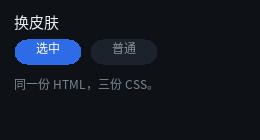
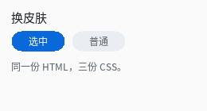
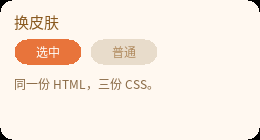

# 换皮肤





完整程序：`example/06_theme/main.c`

三张图是**同一份 HTML**，只有 CSS 不同。例程目录里就是三份 CSS：

```
example/06_theme/
  index.html      结构（三套皮肤共用）
  dark.css
  light.css
  warm.css
```

```html
<!-- example/06_theme/index.html -->
<div id="root">
  <div class="title">换皮肤</div>
  <div class="row">
    <div class="chip on">选中</div>
    <div class="chip">普通</div>
  </div>
  <div class="body">同一份 HTML，三份 CSS。</div>
</div>
```

```c
/* 结构只写一次：换皮肤就是换这一个文件名 */
QLUIDoc *doc = ex_load_ui("index.html", "dark.css");
```

## 为什么这很便宜

编译一次是毫秒级的，而且**产物就是静态表** —— 换完皮肤之后，运行期的性能与
"构建期编译出来的"完全一样：没有解析、没有匹配、没有额外的间接层。

所以"换皮肤"的成本 = 一次编译。可以直接这么写：

```c
void apply_theme(const char *css_path)
{
    QLUIDoc *doc = ex_load_ui("index.html", css_path);   /* 结构每次都一样 */
    if (doc == NULL) {
        fprintf(stderr, "皮肤编译失败，保留旧皮肤：%s\n",
                ql_ui_text_last_error());
        return;                                    /* ← 失败就不换，别半个正确 */
    }
    QLUIRoot *ui = ql_ui_build(doc);
    /* ... 用新的 ui 替换旧的（旧的 ql_ui_free + ql_ui_doc_free） */
}
```

失败时保留旧皮肤是这个例程刻意示范的：**明确失败优于半个正确**。

## 三套主题的差别只有变量

看三份 CSS，它们的**结构完全一样**，只有颜色和圆角不同：

| | 深色 | 浅色 | 暖色 |
|---|---|---|---|
| 背景 | `#0E1116` | `#FAFAFA` | `#241A12` |
| 标题 | `#E6EDF3` | `#1F2328` | `#FFE0B2` |
| 选中态 | `#2E6BE6` | `#0969DA` | `#E8743B` |

真做产品时，这套东西通常会变成一个"主题变量表 + 一次字符串替换"，
或者干脆每个主题一个 `.css` 文件。库本身不提供变量机制 —— CSS 变量（`var()`）
明确不支持，因为那需要运行期求值，与"编译期定死"的设计冲突。

替代方案很直接：**在构建期展开**。用你喜欢的预处理器（或者一个 20 行的 Python
脚本）把 `var(--accent)` 替换成具体颜色，再交给 `qltext`。

## 用外部 CSS 文件

例程支持直接吃一份 CSS：

```bash
./build/example/example_06_theme my.css
```

试着自己改一份 `my.css`（把 `example/06_theme/dark.css` 抄一份改颜色），
跑一下 —— 三分钟内你就能体会到"改界面不用重编译"。

## 存成 `.qlui` 缓存

编译结果可以再序列化成二进制，下次直接加载，连解析都省了：

```c
ql_ui_doc_save(doc, "theme-dark.qlui");   /* 一次 */

/* 之后每次启动 */
QLUIDoc *doc = ql_ui_load_file("theme-dark.qlui");
```

`.qlui` 里就是那份静态数据 + 头部校验（magic / 版本 / 结构体大小 / FNV-1a 校验和）。
损坏的文件会被明确拒绝（7 类损坏输入都有测试），不会画出一半。

> 注意：`.qlui` **不是跨架构可移植的** —— 结构体布局随 ABI 变化。它是"同机缓存"，
> 不是"发布格式"。发布还是走构建期编译。

## 皮肤与"构建期编译"怎么配合

推荐的做法是**两者都用**：

| 用途 | 路径 |
|---|---|
| 界面结构（HTML） | 构建期编译进二进制（零成本） |
| 可选皮肤（CSS） | 运行期编译 + `.qlui` 缓存 |
| 开发调试 | 运行期编译，改完重启就看 |

因为 `ql_ui_load_text` 与构建期 `qltext` 走的是**同一段代码**，两条路径产出的数据**逐字节相同**，可以随便混。

---

上一章：[动画](05_animation.html) ｜ 下一章：[进阶](07_advanced.html)
