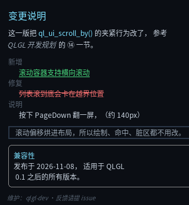
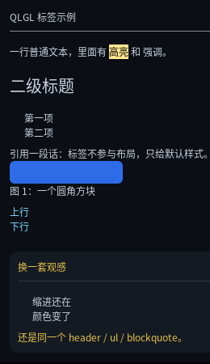

# 标签与语义

这一章讲 HTML 标签。

**先说清楚一件事**：在这套架构里，标签**几乎不参与渲染**。布局和绘制只看编译出来的
`QLUIStyle`（`layout` / `paint` 的字段），不看标签。标签只影响三样东西：

1. **UA 默认样式**（相当于浏览器的内置样式表）；
2. **`tag` 选择器**（`header { color: ... }`）；
3. **调试与查询**（`ql_ui_tag_name(node->src->tag)` 取回 "header"）。

所以"加一个标签"的代价几乎是零，而"标签不够用"的代价很实际：真实 HTML 片段贴进来
直接报错。

## 现支持的 66 个标签

HTML5 一共 114 个元素，本库现在认其中 **66 个**。全量清单（含每个标签的状态、能力包、
MCU 裁剪）在 [HTML5 标签覆盖与裁剪](../manual/ui/HTML5标签覆盖与裁剪.html)，这里只给常用分组：

| 类 | 标签 |
|---|---|
| 容器 / 结构 | `div` `section` `header` `footer` `nav` `main` `article` `aside` `figure` `figcaption` `blockquote` `html` `body` `hgroup` `search` |
| 标题 | `h1` `h2` `h3` `h4` `h5` `h6` |
| 文本块 | `p` `dl` `dt` `dd` `menu` `address` |
| 行内 | `span` `b` `i` `em` `strong` `u` `s` `mark` `del` `ins` |
| 行内（纯语义） | `a` `abbr` `code` `kbd` `samp` `var` `q` `dfn` `cite` `data` `time` `small` `bdi` `bdo` |
| 列表 | `ul` `ol` `li` |
| 空元素 | `hr` `br` `wbr` |
| 控件 | `button` |
| 输入 | `input`（`type` 只支持 `text` / `password`，见[输入控件](11_input.html)） |
| 下拉 | `select` `option` `optgroup`（后两个自动 `display: none`，见[输入控件](11_input.html)） |
| 表单外壳 | `form` `label` `fieldset` `legend`（**没有提交、没有校验**） |

新加的这批叫**纯语义标签**：它们不引入任何新能力，只是"别再报错"。所以要说清楚
哪些看得出区别、哪些看不出：

| 看得出区别 | 为什么 |
|---|---|
| `dl` / `dt` / `dd` | `dl` 有 margin，`dd` 缩进 18px |
| `cite` / `var` / `dfn` / `address` | 斜体（合成斜体，见 §5.4.8 那种） |
| `del` / `ins` | 删除线 / 下划线（装饰线已经支持） |
| `fieldset` | 自带 1px 圆角边框 |

| 看不出区别 | 缺什么 |
|---|---|
| `a` | 没有 `href` 导航、没有光标；就是一段带颜色的文字 |
| `abbr` | 没有 `title` tooltip |
| `code` / `kbd` / `samp` | 没有等宽字体族（`font-family` 还没做） |
| `q` | 没有生成引号（本库没有生成内容） |
| `time` / `data` | `datetime` / `value` 属性被忽略 |
| `small` | 没有相对字号单位（`em` / `smaller`） |
| `bdi` / `bdo` | 没有双向文本（RTL）支持 |
| `wbr` | 没有"可选断点"（不影响折行） |
| `form` / `label` / `legend` / `optgroup` | 纯排版盒子；`optgroup` 的组名不画 |

一张全是语义标签的页面（`dl` 缩进、`cite` 斜体、`del`/`ins` 装饰线、`fieldset` 边框）：



完整程序：`example/11_semantic.c`。

UA 默认样式都很薄，只有"看结构就该知道"的那些：

```css
/* 大致相当于内置样式表的全部内容 */
div, section, header, footer, nav, main, article, aside,
figure, figcaption, blockquote, p, li  { display: block; }
span, b, i, em, strong, u, s           { display: inline; }
h1 { font-size: 24px; margin: 10px 0 }
h2 { font-size: 20px; margin: 9px 0 }   /* …到 h6 递减 */
p  { margin: 8px 0 }
ul, ol { margin: 8px 0; padding-left: 18px }
hr { height: 1px; background-color: #8A8A8A; margin: 8px 0 }
mark { background-color: #FFE58F; color: #000 }
input, select { display: inline-block; /* 内边距 + 边框 + 圆角 */ }
option, optgroup { display: none }        /* 只活在下拉面板里 */
/* 纯语义标签：只给 display，外加几处"真的看得出"的 */
a, abbr, code, kbd, samp, q, data, time, small, bdi, bdo { display: inline; }
cite, var, dfn { display: inline; font-style: italic }
del { display: inline; text-decoration: line-through }
ins { display: inline; text-decoration: underline }
dl  { margin: 8px 0 }
dd  { padding-left: 18px }
menu { margin: 8px 0; padding-left: 18px }
address { font-style: italic }
fieldset { margin: 8px 0; padding: 8px; border: 1px solid #8A8A8A; border-radius: 4px }
```

注意这是**给这个库的观感**调的，不是"和 Chrome 截图一致"调的（比如 `p` 的
margin 是 8px 而不是 1em）。

## 一个完整的文章页



```c
static const char *k_html =
    "<div id=\"root\">"
    "  <header>QLGL 标签示例</header>"
    "  <hr>"
    "  <p>普通文本，<mark>高亮</mark>，<em>强调</em>，<strong>更强</strong>。</p>"
    "  <ul><li>第一项</li><li>第二项</li></ul>"
    "  <blockquote>引用一段话</blockquote>"
    "  <figure><div class=\"box\"></div>"
    "    <figcaption>图 1：一个方块</figcaption></figure>"
    "</div>";

static const char *k_css =
    "#root { width: 260px; background-color: #0B0E14; color: #C8D2DE;"
    "        font-size: 12px; }"
    "header { font-size: 14px; color: #7CE0FF; }"
    "blockquote { margin: 8px 10px; color: #8A94A0; }"
    "figcaption { font-size: 11px; color: #6C7783; }"
    ".box { width: 140px; height: 28px; border-radius: 4px;"
    "       background-color: #2E6BE6; }";
```

完整可运行的版本见 `example/08_tags.c`。

## 三个必须知道的"不完美"

### 1. 字体变体是**合成**的，不是换了字体文件

`b`/`strong` = 加粗，`i`/`em` = 斜体，`u` = 下划线，`s` = 删除线。
它们靠三个"穷人版"实现，不加载第二个字体文件（MCU 上也不可能）：

| 效果 | 做法 | 代价 |
|---|---|---|
| 加粗 | 字形再画一遍，右移 1px | 墨迹多约 1.6 倍（面积），像素级 |
| 斜体 | 按行剪切，顶部右移 `高度 × 0.21` | 每行起点差 1px，行内像素连续写 |
| 下划线 / 删除线 | 画一条 1px 横线 | 1 个矩形 |

这意味着：**小字号下斜体看起来会比较"硬"**（每行只能挪整像素），
加粗也不是真字重的形状。要求高就自己提供粗体字重的字体文件并换 `font-family`
（本库还没有 `font-family`，所以目前就是合成这一条路）。

对应 CSS 是标准写法，可以单独用：

```css
.note { font-weight: bold; font-style: italic; text-decoration: underline; }
```

`font-weight` 也吃数字：`>= 600` 算加粗（`normal` = 400、`bold` = 700）。
`text-decoration` 支持 `underline line-through` 组合，`overline` 明确报错。

### 2. 列表不画项目符号

本库没有生成内容（`::before` / `::marker`），所以 `<ul>` 只给你缩进和块级结构，
`•` 要自己写：

```html
<ul><li>• 第一项</li><li>• 第二项</li></ul>
```

### 3. `<br>` 是一个"高度为 0 的块"

没有生成内容，也没法在一个文本节点里插换行。但**块级元素会结束当前行内行**，
所以一个高度 0 的块刚好等于"换一行"：

```html
<div><span>a</span><br><span>b</span></div>   <!-- a、b 分两行 -->
```

代价是它占一个节点（不是纯文本里的 `\n`）。

## 行内元素之间的空格会被保留

这件事看起来小，但真实 HTML 里到处都是：

```html
<p>plain <mark>mark</mark> <em>em</em> <strong>strong</strong></p>
<!-- 渲染成 "plain mark em strong"，不是 "plain markemstrong" -->
```

规则与 CSS 一致：

| 情况 | 做法 |
|---|---|
| 两个**行内**元素之间只有空白 | 保留成一个空格 |
| 两个**块级**元素之间只有空白 | 丢掉（否则每个缩进都变一行） |
| 行首 / 行尾的空白 | 丢掉 |
| flex 容器里只含空白的项 | 不渲染（CSS：匿名 flex 项只含空白时不生成） |

它是在**解析期**决定的，靠的是标签的**默认** display —— 那时级联还没跑。
所以你把 `span` 改成 `display: block`，这个判断不会跟着变（这种写法本来就该自己管空白）。

## 明确报错的三个标签

写不了就直说，并且告诉你替代做法：

```
HTML: 不支持 （本库没有图片解码器）：装饰用 div + background-image / 圆角做，
      图标用字体字符或 SDF 图元做
HTML: 不支持 <input>（还没有输入控件）：文本展示用 div，点击用 :active/:hover + 事件
HTML: 不支持表格 <table>：用嵌套的 flex 行来做
```

---

上一章：[进阶](07_advanced.html) ｜ 下一章：[滚动](09_scroll.html)
