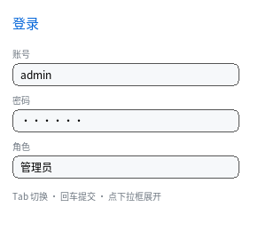

# 输入控件

到这一章为止，界面里所有文字都是**编译期定好**的静态数据 —— 这一章讲唯一两个
例外：`<input>` 与 `<select>`。



完整程序：`example/10_input/main.c`

## `<input>`：单行输入

```html
<input value="admin">                            <!-- 初始值 -->
<input type="password" value="123456">            <!-- 显示成圆点 -->
<input placeholder="请输入用户名">                 <!-- 空值时画占位文字 -->
<input value="只读展示" disabled>                  <!-- 不接焦点、不接输入 -->
```

```c
QLUINodeRT *user = /* 找到那个节点 */;
printf("%s\n", ql_ui_input_value(ui, user));      /* 读值 */
ql_ui_input_set_value(ui, user, "张三");           /* 写值（光标移到末尾） */
```

能做什么：

| 操作 | 触发方式 |
|---|---|
| 定位光标 | 点击 |
| 选一段 | 按下后拖动（多行框按 `(x, y)` 定位，拖出框外会自动滚） |
| 插入字符 | `QL_INPUT_TEXT`（平台层把字符翻译成 UTF-8 后送进来） |
| 删一个字符 | `Backspace` / `Delete`（有选区时删选区） |
| 移动光标 | `←` `→` `Home` `End` |
| 扩展选区 | `Shift` + 上面四个 |
| 收焦点 | `Esc` |
| 通知值变化 / 回车 | `ql_ui_set_input_cb(ui, cb, user)` |

> **空框也有光标**：光标和选区不是"文字"，是输入框的装饰，所以空值聚焦
> 照样画竖线（否则清空内容后就看不见焦点在哪）。
>
> **末尾的空格是真的空格**：普通文本的行尾空格会被裁掉（那是排版需要），
> 输入框不会 —— 在末尾敲空格，值里多一个空格、光标也往右挪一格。

**值和输入框是同一份数据**：`node->text` 直接指向池里的可变缓冲，所以绘制、
`text-align`、横向滚动这些全都不用改 —— 它们读到的就是最新值。

### 值放在哪：一条按需分配的池

```
界面里没有 <input>  →  inputs == NULL          （零字节）
界面里有 3 个        →  3 × QL_CFG_UI_INPUT_LEN 字节
```

上限都是 `config` 里的常量（默认 8 个 × 96 字节）。超长插入**静默截断**：
用户打字不该因为"满了"而失败，但 `ql_ui_input_set_value()` 也照样夹紧。

### 密码框：宽度按圆点算

```
显示文本 = 每个码点一个 '•'
```

绘制时临时换成圆点串再走原来的文本管线，因此**测宽必须按圆点量** ——
否则 12 个汉字的真实宽度和 12 个圆点的宽度差一大截，光标会飘到框外去。

### 没有的东西（都是有意留白）

| 缺 | 原因 / 替代 |
|---|---|
| 输入法（IME） | 平台层负责把上屏文本变成一个 `QL_INPUT_TEXT`；本库不猜候选框。X11 侧已接 XIM（见第 13 章的四件事） |
| 光标闪烁 | 闪烁要求主循环一直醒着，省电优先 |
| `maxlength` / `required` / `pattern` | 属性不影响渲染，静默忽略；长度上限是 `QL_CFG_UI_INPUT_LEN` |
| `readonly` | 静默忽略 —— 要只读就别接 `input_cb`，或直接写 `disabled` |

### `placeholder`：一份独立的样式

```css
.inp::placeholder { color: #5E6B7A; font-style: italic; }
```

构建期把 `::placeholder` 的声明**合并进宿主样式**，单独存一份"占位样式"，
运行期只在值为空时用它画。所以占位文字能吃任何 CSS（颜色、字号、行高），
但它不是节点，拿不到事件。

### `disabled`：不是"变灰"，是"不接输入"

```html
<button class="btn" disabled>提交</button>
```

`disabled` 只做两件事：**拿不到焦点**（Tab 跳过）、**不接点击和输入**
（输入框点了也不出光标）。"变灰"要自己写样式：

```css
.btn:disabled { background-color: #2A3442; color: #6C7783; }
```

运行期也能改：直接动 `node->flags` 上的 `QL_UI_RT_DISABLED` 位，然后标脏。
`:disabled` / `:enabled` 是两份构建期编好的变体样式，运行期只翻一个位。

## `<textarea>`：多行输入

```html
<textarea>第一行文字
第二行</textarea>
```

> `rows` / `cols` **属性不解析**（HTML 属性进不了样式表），尺寸请写 CSS：
> `textarea { width: 320px; height: 96px; }`。默认是 200×60、等宽字体、
> `white-space: pre-wrap`。

它复用输入框的**同一套 API**：`ql_ui_input_value()` 读值、
`ql_ui_input_set_value()` 写值、`ql_ui_set_input_cb()` 接回调。
差别只在排版与编辑：

| 差别 | 说明 |
|---|---|
| 文本存储 | 不在单行框的池里，而是共享一块 `QL_CFG_UI_TEXTAREA_LEN` 的 arena（大得多） |
| 换行 | 内容里的 `\n` 是硬换行；软换行按容器宽度算 |
| 光标 | 按 `(x, y)` 定位到**视觉行**，`↑` `↓` 跨行；拖出框外会自动滚 |
| 空白 | 和 `<pre>` 一样保留（`white-space: pre-wrap`） |

上限由 `QL_CFG_UI_TEXTAREA_LEN` 决定（默认 512 字节/个），超长插入静默截断。

## `<input type="checkbox">` / `type="radio"`

```html
<input class="cb" type="checkbox">
<input class="cb" type="checkbox" checked>          <!-- 初始勾选 -->
<input class="cb" type="checkbox" checked disabled> <!-- 勾着且禁用 -->
```

```c
/* 点击回调里读状态：勾选位在运行期 flags 上 */
if ((node->src->flags & QL_UI_NODE_CHECKBOX) != 0)
    printf("%s\n", (node->flags & QL_UI_RT_CHECKED) ? "已勾选" : "未勾选");
```

- 尺寸由 UA 默认给 16×16、没有内边距 —— 要改就写 `width` / `height`；
- **不进输入框池**（它没有文本）；
- 点一下切换 `QL_UI_RT_CHECKED` 并标脏，勾上时画两条斜线组成的 `√`；
- 样式走 `:checked` 变体；`disabled` 之后点了不动；
- `radio` 目前画成同样的方框（没有"同组互斥"语义），要单选组请自己维护状态。

## 剪贴板：Ctrl+C / V / X

界面层只定义**后端接口**，平台层去实现：

```c
typedef struct {
    void (*set_text)(const char *utf8, void *user);
    /* 1 = 内容已就绪；0 = 还没到（内部已发请求，下一帧再问） */
    int  (*get_text)(char *buf, size_t cap, void *user);
} QLUIClipboard;
```

GL/X11 后端一行接好：

```c
ql_gfx_gl_attach_clipboard(gfx, ui);
```

X11 的剪贴板是**点对点异步协议**（粘贴要等对方回 `SelectionNotify`），
所以 `get_text()` 可以返回 0 —— 界面层会记住这次粘贴，在 `ql_ui_anim_tick()`
里重试。没装后端时 Ctrl+C/V 什么也不做（不报错，MCU 上就是这种情况）。

也可以直接用 API：

```c
ql_ui_clipboard_copy(ui);   /* 当前焦点输入框的选区；没有选区时复制全文 */
ql_ui_clipboard_cut(ui);
ql_ui_clipboard_paste(ui);  /* 结果在下一帧到（异步） */
```

## `<select>`：覆盖式下拉面板

```html
<select>
  <option>管理员</option>
  <option>编辑</option>
  <option>访客</option>
</select>
```

```c
int i = ql_ui_select_index(ui, sel);              /* 当前第几项 */
ql_ui_select_set_index(ui, sel, 2);               /* 设置（越界夹紧） */
ql_ui_set_select_cb(ui, cb, user);                /* 用户改了选中项 */
```

三件事值得说：

1. **`<option>` 自动 `display: none`**。它只活在面板里，不进布局 —— 所以不要给
   它写尺寸，也不要指望它占位置。
2. **面板是覆盖层**。它不占布局、不受父级 `overflow` 裁剪、画在最后一层
   （`ql_ui_render` 末尾单独画一次）。这和浏览器的 popup 一致。
3. **同一时刻只开一个**。`ui->open_select` 只存一个指针。

行为：

| 输入 | 行为 |
|---|---|
| 点下拉框 | 展开；再点一次收起 |
| 点面板某一项 | 选中并收起 |
| 点面板外 | 只收起，不改选中 |
| 焦点在下拉框上时 `↑` `↓` | 改选中项（到头停住，不绕回） |
| 焦点在下拉框上时 `空格` / `回车` | 展开 / 收起 |

## Tab 键：焦点在控件之间循环

```
input → select → button → input → …
```

按**树序**找下一个 `input` / `select` / `button`（`display: none` 的跳过），
到头上绕回。`Shift+Tab` 反向。

```c
ql_ui_set_focus_node(ui, node);                   /* 也可以程序设焦点 */
QLUINodeRT *f = ql_ui_focus_node(ui);
```

焦点连带的还有 `:focus` 伪类 —— 输入框常见的做法是 `input:focus { ... }`。

## 和滚动配合

输入框比盒子宽时自己横向滚（`scroll_x`，**不影响布局**），下拉面板可以被
关在滚动容器里面画到外面来。这两点都不需要额外代码：前者是绘制期的处理，
后者是覆盖层的自然结果。

---

上一章：[与 Web 的差别](10_vs_web.html)
