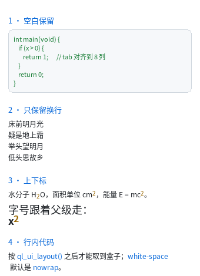

# 空白与上下标

到这一章为止，文本一直是"折叠空白 + 一行一段"。这一章加上两种"文本里的真内容"：

- **`<pre>`** —— 空白与换行全部保留，不自动折行
- **`<sub>` / `<sup>`** —— 基线偏移 + 缩小字号



完整程序：`example/12_text_block/main.c`

## 为什么这件事不简单

"保留空白"听起来只是不折叠，但它撞上了一个架构问题：

> **空白折叠是解析期做的，而 `white-space` 是级联之后才知道的。**

本库的解法是把**折叠推迟到建表期**：原始文本一路留到样式算好之后，那时才决定
"折叠"还是"原样保留"。代价只是编译期的临时内存，静态产物的字节不受影响
（`test_golden` 守着 28 个页面的 blob 逐字节不变）。

## `<pre>`：代码块

```html
<pre>int main(void) {
    if (x > 0) {
        return 1;
    }
}</pre>
```

UA 默认给了三样东西：

| 属性 | 值 | 为什么 |
|---|---|---|
| `display` | `block` | 代码块前后断行 |
| `white-space` | `pre` | 空白与换行全保留、**不折行** |
| `margin` | `8px 0` | 与 `<p>` 一致的块间距 |

**两条必踩的坑**（都是规范行为，不是 bug）：

1. **源码缩进会画出来。** `<pre>` 里每一行的行首空格都是内容。所以写
   `<pre>  代码</pre>` 时那两格空格真的会出现。要好看就把 `<pre>` 的内容顶格写。
2. **起始标签后紧接的一个换行会被丢掉。** 这是 HTML 的 "ignore the first newline"
   规则 —— 不做这一步，写 `<pre>\n  x\n</pre>` 每个代码块开头都多一个空行。

`\t` 会展开成**空格**（制表位 8 列，按行列号算），否则制表符落到字体查不到的字形上、
宽度 0，整块缩进消失。

## `white-space` 的四个值

| 值 | 空白 | 换行 `\n` | 自动折行 |
|---|---|---|---|
| `nowrap`（**默认**） | 折叠 | 保留 | 不折 |
| `normal` | 折叠 | 保留 | 折 |
| `pre` | 保留 | 保留 | 不折 |
| `pre-wrap` | 保留 | 保留 | 折 |
| `pre-line` | 折叠 | 保留 | 折 |

> **默认是 `nowrap` 而不是浏览器的 `normal`**，这是本库的故意差异：v0 的文本模型是
> "一段文本就是一行"，大量已有界面（含 golden 基准）建立在这个前提上。改成 `normal`
> 会让那些页面在你没改任何东西的情况下重新排版。想要折行就显式写一行 CSS。

`pre-line` 特别适合"按行写"的内容（诗句、地址、歌词）：多余空格折叠，换行保留。

```html
<div class="poem">床前明月光
疑是地上霜</div>
```

```css
.poem { white-space: pre-line; }
```

## `<sub>` / `<sup>`：上下标

```html
<p>水分子 H<sub>2</sub>O，面积单位 cm<sup>2</sup>。</p>
```

UA 默认是 `vertical-align: sub|super` + `font-size: smaller`，两个都真的实现了：

| 机制 | 怎么算 | 备注 |
|---|---|---|
| `font-size: smaller` | 父级字号 × 5/6 | 相对父级，所以标题里的上标也协调 |
| `font-size: larger` | 父级字号 × 6/5 | 同上 |
| `vertical-align: super` | 基线 **−33%** 字号 | 16px 的 `<sup>` → 字号 13px → 上移 4px |
| `vertical-align: sub` | 基线 **+20%** 字号 | 同上 |
| `vertical-align: baseline` | 0 | 默认 |

**行盒高度不会因为上下标变大**（与浏览器一致）。所以极端情况下上标可能顶到
上一行的空隙里 —— 要干净就显式给 `line-height`。

`vertical-align` 只支持 `baseline` / `sub` / `super` 三个值：`middle` / `top` / `bottom`
要按**行盒**对齐，那是行内格式化上下文的事，本库还没有。写了会明确报错。

## 等宽字体

`<pre>` / `<code>` / `<kbd>` / `<samp>` 的 `font-family` 都是 `monospace`，
`QLUIStyle.font_family` 因此有两个值：

| 值 | 字体 | 说明 |
|---|---|---|
| `QL_UI_FAMILY_DEFAULT` | `ql_font_default(px)` | 正文 |
| `QL_UI_FAMILY_MONO` | `ql_font_mono(px)` | 等宽 |

**内建位图字体本来就是等宽的**，所以不接矢量字体时两级完全一样。
接了 FreeType 之后才分得开：

```c
ql_font_set_default_factory(my_proportional_factory);   /* 正文 */
ql_font_set_mono_factory(my_mono_factory);              /* 等宽 */
```

写 `font-family: Arial, sans-serif` 这种**不会报错**，会落到正文 ——
"没有 Arial"不该让整页编译不过。候选表里出现 `mono` 才取等宽。

## 与浏览器不同的地方

1. **默认 `white-space: nowrap`**（见上）。
2. **`<pre>` 的行尾空格会被去掉。** 不可见，除非你给整行加 `text-decoration: underline`。
3. **`tab-size` 固定 8**，不能用 CSS 改。
4. **`vertical-align` 只认三个值**，`middle`/`top`/`bottom` 明确报错。
5. **字体族只有两级**（正文 / 等宽），不是任意 `font-family` 列表。

## 接下来

下一章把这些控件凑成一个能填的表单 —— `<textarea>` 多行编辑。
