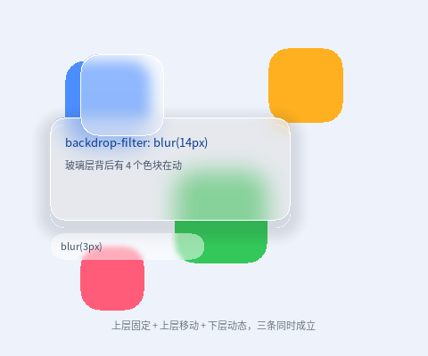

# 毛玻璃叠在动的背景上



完整程序：`example/15_backdrop/main.c`

这一章只讲一件事：**一个半透明 + 高斯模糊的层，压在另一个"正在动"的层上，
下面变了上面的模糊会不会跟着变**。答案是会，而且是每帧跟着变、不用整屏重绘。

```css
#card {
  background-color: rgba(255, 255, 255, 0.42);   /* 半透明：这一句不能少 */
  backdrop-filter: blur(14px);                    /* 模糊"背后已经画好的内容" */
  border-radius: 16px;
}
```

---

## 1. 它为什么天然"实时"

本库没有保留式场景图，`backdrop-filter` 的实现是**就地把这块区域里已经画好的
像素糊一遍**（CPU）或**把帧缓冲里这块区域 blit 出来糊两趟再贴回去**（GPU）。

所以"跟随下层变化"不是额外做的工作，而是"重画这一帧"的必然结果：

```
第 N 帧：画色块（新位置） → 画玻璃卡 → 取卡下面的像素 → 模糊 → 贴回
```

三层玻璃在本例里分别验证三件事：

| 元素 | 验证什么 |
|---|---|
| `#card`（固定） | 色块从它底下穿过时，模糊内容跟着变 —— **实时跟随** |
| `#puck`（自己也在动） | 模糊区域跟着玻璃层自己走 |
| `#pill`（`blur(3px)`） | 小半径与 `blur(14px)` 的观感差别 |

## 2. 三个必踩的坑

### 2.1 玻璃层必须半透明

最常见的一句错话是"我写了 `backdrop-filter` 但没效果"。原因几乎总是：

```css
#card { background-color: #FFFFFF; backdrop-filter: blur(14px); }  /* ❌ */
```

模糊确实做了，紧接着元素自己那块**不透明**背景把它整个盖住了。写成
`rgba(255,255,255,0.42)` 才看得见背后的糊。

### 2.2 `border-radius` 缺口里会渗出方形模糊块

模糊是方框运算，元素却是圆角的。不做处理的话，圆角**缺口**里会渗出颜色 ——
那是模糊结果，它跑到了元素边框盒之外，CSS 里不该出现。

本库的做法是把模糊结果裁进圆角：CPU 侧只处理四个 `corner×corner` 角落
（先存原像素、糊完按圆角覆盖率混回去），GPU 侧沿用同一个 `sdRoundBox` SDF
把片元的 alpha 压到 0，两条后端语义一致。

对应的 API 是 `ql_canvas_backdrop_blur_round()` / `ql_draw2d_backdrop_blur_round()`；
`ql_ui.c` 会自动把 `border-radius` 传下去，所以写 CSS 的人不用管这件事。

### 2.3 下层用 `@keyframes` + `transform`，不要动 `width/height`

动画白名单只允许绘制属性（`background*` / `opacity` / `transform` / `color` /
`border-*` / `border-radius` / `clip-path`）。写 `width` 会直接构建期报错 ——
改尺寸意味着每帧重排，与本库"动画零重排"的红线冲突。

## 3. 脏区模式下也跟得上

`ql_ui_consume_dirty()` 交出来的脏区里，只要有一块与玻璃元素相交，
玻璃就会重新取"背后的像素"再糊一次。所以不需要为了毛玻璃关掉脏区优化。

有一个**已知边界**：如果下层的变化只覆盖玻璃元素的一小块，那么只有那一小块
被重新模糊 —— 模糊核够不到矩形外的邻居像素，边缘可能出现细接缝。
需要绝对干净时，把带 `backdrop-filter` 的元素整体当成脏区。

## 4. 代价

| 后端 | 一次 `blur(r)` 的代价 | 备注 |
|---|---|---|
| CPU | 4 趟（H/V × 2）扫描 + 两块临时缓冲，与面积 × r 相关 | 只在这块区域上发生 |
| GPU | 半分辨率 blit + 两趟 9 抽头 + 一次合成 | 基本可以当免费 |

`r` 被限制在 `1~64px`，写 `blur(0)` 或 `blur(80px)` 都是构建期报错
（明确失败优于半个正确）。

## 5. 跑起来看

```bash
./build/example/example_15_backdrop
./build/example/example_15_backdrop --size 320x280   # 窄窗口
./build/example/example_15_backdrop --frames 120 --dump /tmp/15.ppm
```

> 顺手记一条布局上的坑：本例把 `position: relative` 直接放在 `#root` 上，
> 没有额外套一层 `#stage { height: 100% }`。因为**普通元素的 `height: 100%`
> 目前不会去解析父元素的百分比高度**，多套一层会变成 0 高（`overflow: hidden`
> 一裁，画面全空）。根元素自己相对视口，是确定高度，所以能直接用。
