# CSS 效果检阅：十五个例程

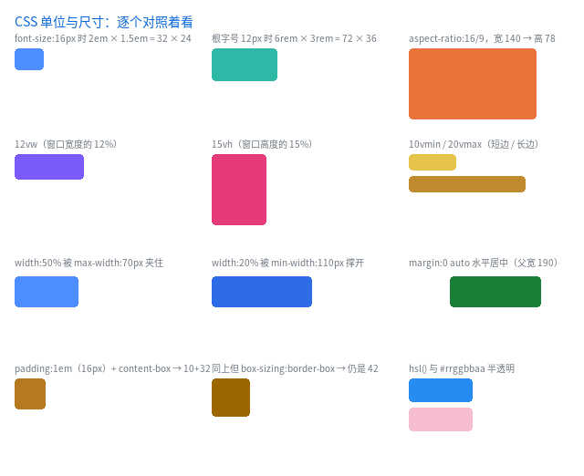

完整程序：`example/16_css_units/` … `example/30_border_image/`（每个例程一个文件夹）

前几章是按"补了什么"讲的（[CSS3 补全](14_css3.md)、[毛玻璃](15_backdrop.md)）。
这一章反过来：**按"能看出效果的最小样本"讲** —— 每一个已支持的 CSS 效果都摆成
一格，旁边写着它该是什么值。跑起来一眼就能看出哪一格不对。

```bash
cmake --build build -j
./build/example/example_16_css_units        # 单位与尺寸
./build/example/example_17_css_selectors    # 选择器与伪元素
./build/example/example_18_css_paint        # 绘制效果
```

每个例程一份 `index.html` + `style.css`，都可以直接改、直接重跑 —— 例程在运行期
读文件，不重新编译。

---

## 1. `16_css_units`：单位与尺寸


| 格 | 验证什么 | 该看到什么 |
|---|---|---|
| `2em × 1.5em` | `em` 相对**元素自己**的 `font-size: 16px` | 32 × 24 |
| `6rem × 3rem` | `rem` 相对**根**字号 `12px` | 72 × 36 |
| `aspect-ratio: 16/9` | 只给宽 140，高由比例推出来 | 140 × 78 |
| `12vw` | 视口宽的 12% | 随窗口宽度变 |
| `15vh` | 视口高的 15% | 随窗口高度变 |
| `10vmin` / `20vmax` | 短边 / 长边（不跟横竖方向走） | 52 / 128 |
| `width: 50%` + `max-width: 70px` | 上限夹住 | 70 |
| `width: 20%` + `min-width: 110px` | 下限撑开 | 110 |
| `margin: 0 auto` | 块级元素水平居中 | 卡片在父盒里居中 |
| `padding: 1em`（两种 `box-sizing`） | `content-box` 外框 42，`border-box` 仍 42 | 两个方块一样大 |
| `hsl()` / `#rrggbbaa` | 颜色写法 | 蓝 / 半透明粉 |

**这几个单位什么时候折成像素**，是理解本库的关键：

| 单位 | 什么时候算 | 为什么 |
|---|---|---|
| `px` / `%` | 布局期 | `%` 要包含块宽度 |
| `em` | **构建期**（编译样式那一刻就折成 px） | 字号那时已确定 |
| `rem` | 构建期末尾（整棵树走完再折） | 根字号自身也可能是 `em` |
| `vw` / `vh` / `vmin` / `vmax` | 布局期 | 只有布局时才知道视口多大 |

## 2. `17_css_selectors`：选择器与伪元素

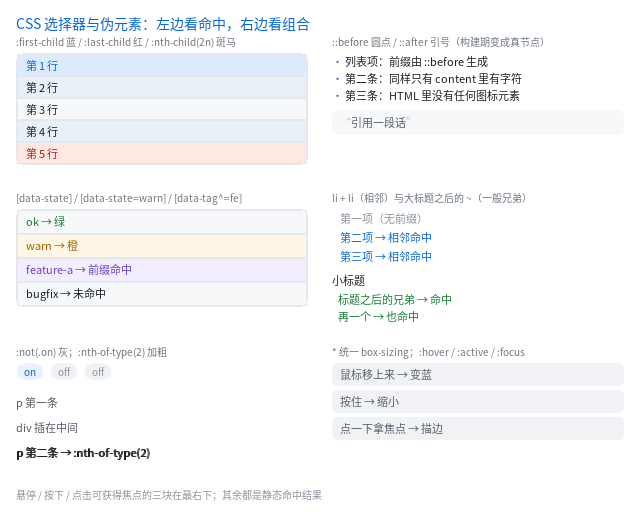

左列是**单条件命中**，右列是**组合与生成**。例程自己会数节点：

```
节点 60 个，其中 ::before 生成的圆点 5 个
```

| 格 | 验证什么 |
|---|---|
| `:first-child` / `:last-child` / `:nth-child(2n)` | 五行里第一行蓝、最后一行红、偶数行斑马 |
| `[data-state]` / `[data-state=warn]` / `[data-tag^=fe]` | 属性存在 / 精确 / 前缀三种 |
| `:not(.on)` | 两个 `off` 变灰，`on` 保持原样 |
| `p:nth-of-type(2)` | 只加粗第二个 `<p>`（中间夹着的 `<div>` 不干扰计数） |
| `::before` / `::after` + `content` | 三条竖线是**圆点**，引用前后有引号 |
| `.s + .s` | 第二、三项变色（相邻兄弟） |
| `.gh ~ .after-h3` | 小标题之后的所有兄弟都命中 |
| `*` | 统一 `box-sizing` |
| `:hover` / `:active` / `:focus` | 鼠标移上去变蓝、按住变红、点一下拿焦点出描边 |

**伪元素在这里是"真节点"**：构建期 `::before` 被展开成一个内容为 `content` 的
节点，运行期完全不知道有伪元素这回事。宿主自己有文字时（`<div>正文</div>`），
那段文字也会被挪进一个匿名 `<span>` —— 否则它和圆点都从内容盒原点开始排，
两样东西会叠在一起。这条路径和"文本 + 行内元素混排"是同一份实现
（见 [QLUI API 手册](../手册/ui/QLUI%20API手册.md) §3.4）。

## 3. `18_css_paint`：绘制效果

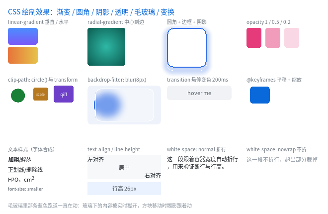

| 格 | 验证什么 |
|---|---|
| `linear-gradient` 垂直 / 水平 | 行填充快路径与逐像素插值 |
| `radial-gradient` | 圆心在中心，按到最远角归一化 |
| `border-radius` + `border` + `box-shadow` | 圆角、描边、外阴影一起画 |
| `opacity: 1 / 0.5 / 0.2` | 逐图元降低不透明度 |
| `clip-path: circle(50%)` | 圆形裁剪 |
| `transform: scale()` / `scaleX(-1)` | 缩放与水平镜像 |
| `backdrop-filter: blur(8px)` | **糊的是下面已经画好的像素**，那个蓝色方块一直在动，糊影跟着动 |
| `transition` | 鼠标移上去 200ms 变色 |
| `@keyframes` | 平移 + 缩放循环 |
| 文本样式 | `bold` / `italic` / `underline` / `line-through` / `sub` / `sup` / `smaller` |
| `text-align` / `line-height` | 左 / 中 / 右与行高 |
| `white-space` | `normal` 折行、`nowrap` 不折（溢出裁掉） |

毛玻璃那一格是这个例程的重点：**跑道先画、玻璃后画**，玻璃里看到的是跑道
被糊开的样子，而且是每帧重新糊的。

## 4. `19_css_text`：文本细节

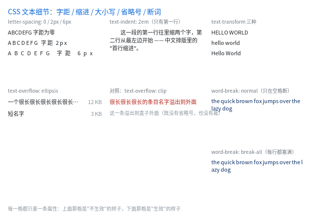

完整程序：`example/19_css_text/`

| 格 | 验证什么 | 该看到什么 |
|---|---|---|
| `letter-spacing: 0 / 2px / 6px` | 字距加在**每个字符之后** | 三行同一串字，一行比一行松 |
| `text-indent: 2em` | 首行缩进（只第一行） | 第一行缩进两个字，第二行顶格 |
| `text-transform` 三种 | `uppercase` / `lowercase` / `capitalize` | `HELLO WORLD` / `hello world` / `Hello World` |
| `text-overflow: ellipsis` | 列表项经典写法：左名字自动缩、右数字固定宽 | 超长的名字变 `…`，右边的 `12 KB` 不动 |
| 对照：`text-overflow: clip` | 不省略会怎样 | 红字溢出到盒子外面 |
| `word-break: normal` / `break-all` | 折行时允许断在哪里 | 同一句英文，normal 在空格断（右边参差），break-all 每行塞满（右边齐） |

两条容易踩的：

- **本库默认 `white-space: nowrap`**（与浏览器不同），要折行必须显式写 `white-space: normal`；
- 写例程时别把类名起成 `.cap` —— `text-transform` 会被同名标题类一起套上（我第一版就把所有标题变成了大写）。

## 5. `20_live_reload`：改 CSS 窗口自己变

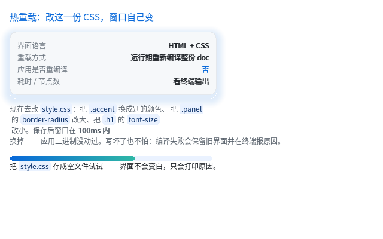

完整程序：`example/20_live_reload/`

```bash
./build/example/example_20_live_reload
# 另开编辑器改 example/20_live_reload/style.css，保存
```

终端会打印 `重载：41 个节点，17 个样式，1 ms` —— **应用二进制没动过**。

原理只有一句：界面是可以在运行期编译的（`ql_ui_load_text`），所以热重载 = 重新读文件 +
重新建树。新文件写坏了会**保留旧界面**并打印原因（"明确失败优于半个正确"）。
这件事和"设计工具"是同一套东西，见 [对比与取舍 §12](../design/对比与取舍.html)。

## 6. `21_css_vars`：一处定义，处处引用


完整程序：`example/21_css_vars/`

```css
#root { --brand: #0969DA; --line: #E4E8ED; --radius: 10px; }
.title { color: var(--brand); }
.btn   { background-color: var(--brand); }
.card  { border: 1px solid var(--line); border-radius: var(--radius); }

.promo { --brand: #8250DF; }   /* 局部换肤：只影响这棵子树 */
```

例程里有两张卡片：第二张在自己身上改了 `--brand`，于是它的按钮和标题变紫，
第一张不受影响 —— 这就是"变量参与级联"的意思。

**为什么在 qlgl 里特别便宜**：变量在**构建期**就被换成了字面量
（级联之后、属性解析之前），所以 `QLUIStyle` 和 blob 格式一个字节都没变，
`compile_style()` 根本不知道有变量这回事。代价是**不能运行期改变量** ——
换肤请换一份 CSS，或者用上一节的 `20_live_reload` 直接热重载。

## 7. `22_media`：拖窗口就换布局

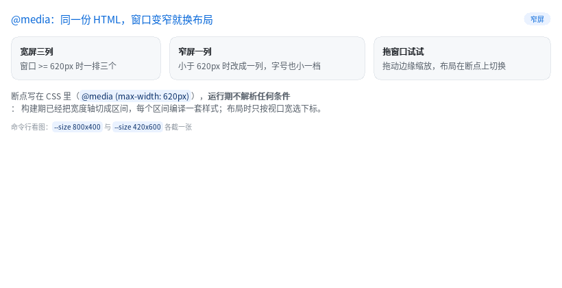
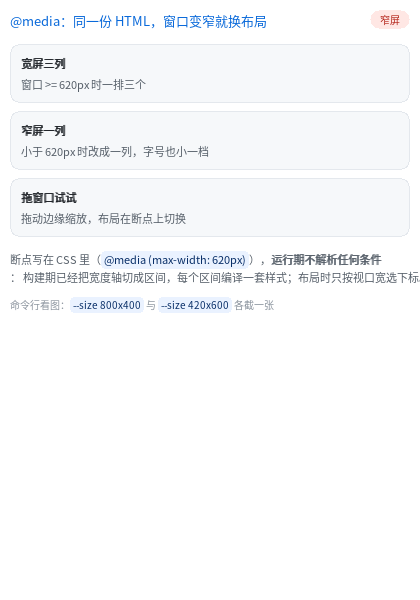

完整程序：`example/22_media/`

```css
.row { display: flex; gap: 12px; }

@media (max-width: 620px) {
  .row { flex-direction: column; gap: 8px; }   /* 一排三个 → 一列 */
  .h1  { font-size: 13px; }                    /* 字号小一档 */
  .badge { background-color: #FFE7E4; color: #B42318; }
}
```

```bash
./build/example/example_22_media --size 820x420 --dump wide.ppm
./build/example/example_22_media --size 420x600 --dump narrow.ppm
```

**运行期不解析任何条件**：构建期已经把宽度轴切成区间（这个例程是 `[0,620]` 与
`[621,∞)`），每个区间编译一套样式；布局时只按视口宽选下标。拖窗口边缘就能看到
切换（不需要重新编译，也不需要重载文件）。

写这一节时踩到两个真 bug，都修了：

1. **多趟编译必须清空 `final_decls`** —— 它是"往 out 里合并"的，不清的话上一个断点
   独有的声明（`flex-direction: column`）会残留到下一个断点，表现是"宽屏也是竖排"；
2. **列方向的最大内容高度要"求和"而不是"取最大"** —— 一个带 padding、里面两行文字
   的卡片，在 column 布局里高度被算成一行，后面的兄弟直接压上来。

## 8. `23_calc`：布局期的算术

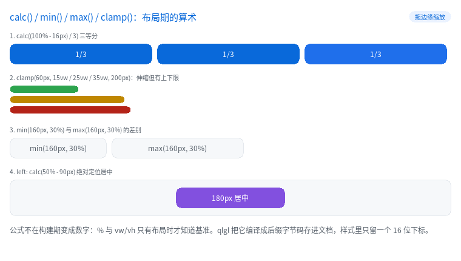
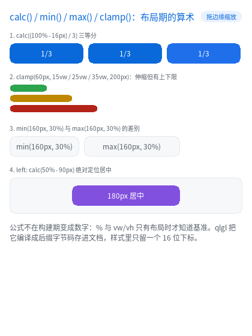

完整程序：`example/23_calc/`

```css
.trio > .cell { width: calc((100% - 16px) / 3); margin-right: 8px; }  /* 三等分 */
.b1 { width: clamp(60px, 15vw, 200px); }                             /* 伸缩但有上下限 */
.card      { width: min(160px, 30%); }
.card.wide { width: max(160px, 30%); }
.mid { position: absolute; left: calc(50% - 90px); }                  /* 居中 */
```

```bash
./build/example/example_23_calc --size 760x430 --dump wide.ppm
./build/example/example_23_calc --size 420x560 --dump narrow.ppm
```

例程启动时会把文档里的字节码打出来，可以直接看到 `calc((100% - 16px) / 3)` 的形状：

```
calc 字节码 35 条（每条 4 字节）
  [ 0] TERM  value=33 unit=2      ← 33%   （除以 3 已折进操作数）
  [ 1] TERM  value=5  unit=1      ← 5px
  [ 2] SUB   n=0
  [ 3] END   n=0
```

**为什么不能算成数字**：`%` 的基准是父内容盒、`vw` 的基准是视口，都只有布局时才知道。
所以公式编译成后缀字节码（每条 4 字节）存在文档里，样式字段只留一个 16 位下标；
布局时用一个 16 深的栈求值 —— 没有递归，也没有分配。

写这一节时又查出一个**老 bug**（与 `calc` 无关，是它把问题放大了）：

- flex 项的 `width: 50%` 被解析**两遍** —— `measure` 一遍（基准 = 容器内容宽），
  真正 `layout_node` 时又拿"这一项自己的尺寸"当基准来一遍，于是 50% 变成四分之一。
  带 `25% + 10px` 的 `calc()` 会让它更明显（px 项被减两次）。
  修法：主轴上的 `%` / `calc()` 在 `measure` 阶段就折成 px 写回 `style_copy`。

## 9. `24_b5`：十二个"只加开关"的属性

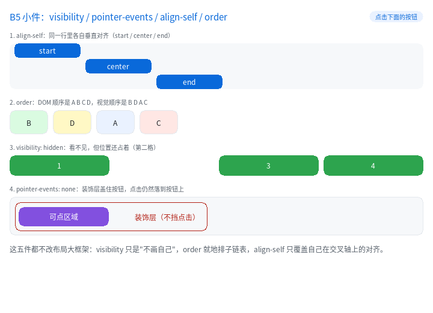

完整程序：`example/24_b5/`

```css
.box.c  { align-self: center; }        /* 同一行里各自垂直对齐 */
.oa     { order: 3; }                  /* DOM 顺序 A B C D，视觉顺序 B D A C */
.hide   { visibility: hidden; }         /* 看不见，但位置还占着 */
.deco   { pointer-events: none; }       /* 盖在按钮上的装饰层不挡点击 */
.row    { flex-flow: row wrap; }        /* flex-direction + flex-wrap 的简写 */

.lhead  { position: sticky; top: 0; }   /* 列表滚动时表头钉在顶部 */
.wrapbox{ align-content: space-between; }  /* 多行在交叉轴上均分 */
.strip  { overflow-x: hidden; overflow-y: visible; }  /* 只裁横向 */
```

```bash
./build/example/example_24_b5 --size 720x520 --dump b5.ppm
```

点一下紫色按钮：装饰层是 `pointer-events: none`，点击**穿过**它落到按钮上
（终端打印命中的节点）。把那一行删掉再跑，点击就只会命中装饰层。

`position: sticky` 是"布局末尾的一次补偿平移"：滚动已经由 `apply_scroll`
把子树整体平移过，sticky 再把自己推回可视边缘，改的是 `border_box` ——
所以绘制、命中、脏区、`paint_box` 全都自动正确。约束在自己的**包含块**里，
所以列表滚到头它会跟着一起走（不是永远钉着）。

写这一节时又查出一个**真缺陷**（这一轮最有价值的发现）：

- `align-items: center / flex-end` 在"容器有确定高度、只有一行"这个**最常见**的
  情况下完全没有效果 —— 单行的交叉尺寸取的是"各项最大值"，剩余空间恒为 0。
  CSS 的默认 `align-content: stretch` 要求单行撑满容器的交叉尺寸，补上之后
  `align-items` 才真的能用（golden 的 `align` 页因此变化，肉眼核对过：
  两个方块现在在 120px 高的容器里居中）。多行的 `align-content` 后来也补齐了
  （`center` / `end` / `space-between` / `space-around` / `space-evenly` / `stretch`）。

## 10. `25_b4`：虚线边框、四边四角、阴影、滚动条

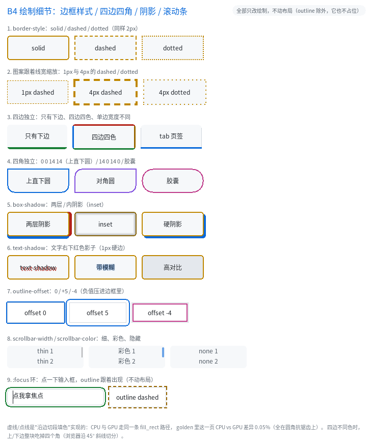

完整程序：`example/25_b4/`

```css
.a { border: 2px dashed #E0A030; }        /* 虚线：段 3w、缝 2w，跟着线宽缩放 */
.b { border: 2px dotted #E0A030; }        /* 点线：点 1w、缝 1w */
.c { border-width: 4px; border-style: none; }  /* 宽度归零，不占位 */

.e { border-width: 0 0 4px 0; }           /* 只有下边（上右下左） */
.f { border-width: 3px; border-style: solid;
     border-top-color: #EF4444; border-left-color: #38BDF8; }  /* 四边异色 */
.g { border-radius: 0 0 14px 14px; }      /* 上直下圆 */
.h { border-radius: 14px 0 14px 0; }      /* 对角圆 */

.i { box-shadow: 5px 0 0 #EF4444, 0 5px 0 #38BDF8; }  /* 两层 */
.j { box-shadow: inset 0 0 8px #000000; }             /* 内阴影 */
.k { text-shadow: 2px 2px 0 #EF4444; }

.d { outline: 2px solid #38BDF8; }        /* 画在边框盒**外面**，不占布局 */
.d { outline-offset: 5px; }               /* 往外推 5px */
.d { outline-offset: -4px; }              /* 负值压进边框里面 */
.inp:focus { outline: 2px solid #4ADE80; outline-offset: 2px; }  /* focus 环 */

.s1 { scrollbar-width: thin; }            /* 2px 滚动条 */
.s2 { scrollbar-color: #38BDF8; }         /* 彩色滑块 */
.s3 { scrollbar-width: none; }            /* 干脆不画 */
```

```bash
./build/example/example_25_b4 --size 720x760 --dump b4.ppm
```

三件事值得记：

- **虚线是"沿边切段填矩形"**，不碰 SDF：CPU 与 GPU 走同一条 `fill_rect`，
  所以两条后端逐像素一致（golden 的 `b4` 页 CPU vs GPU 差异 0.5%，
  全在圆角抗锯齿上）。代价是 `border-radius` 配 dashed/dotted 时按直角画。
- **`border-style: none` 会把宽度按 0 算**（CSS 语义）。只清样式不清宽度的实现
  会让内容盒莫名缩水 2×width —— 例程第 6 节就是拿它跟 `solid` 比尺寸。
- **`outline` 天生适合 focus 环**：它不占布局，所以出现/消失不会让页面抖一下。
  注意 CSS 语义：`outline-width` 单独写**不画**（`outline-style` 初值是 `none`），
  要画就用 `outline: 2px solid <色>` 简写。
- **四边不同色 + 圆角**时，角部整块归上/下边（浏览器是沿 45° 斜线切分）。
  这条例程第 3 节能直接看出来：`四边四色` 那个盒子的上边是红的、左右各自本色，
  但两个上角没有斜切。
- **`box-shadow` 最多两层**，多写的会**报错**而不是静默丢弃 —— 少一层阴影
  在界面上很难发现，宁可构建期就炸。

## 11. `26_css_states`：状态选择器

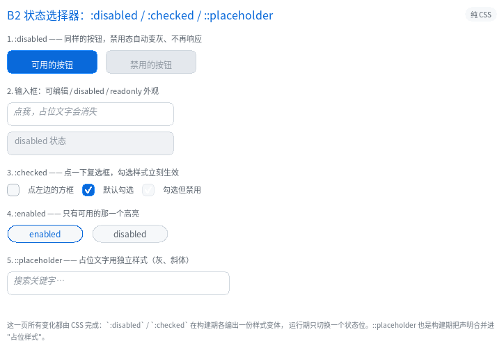

```css
.btn:disabled { background-color: #2A3442; color: #6C7783; }
.inp:disabled { background-color: #141B24; color: #66707C; }
.cb:checked   { background-color: #2E6BE6; }
.chip:enabled { color: #7CE0FF; border-color: #2E6BE6; }
.inp::placeholder { color: #5E6B7A; font-style: italic; }
```

点一下复选框，`:checked` 立刻生效；禁用的输入框点了不出光标（也拿不到焦点）。

## 12. `27_css_text2`：词间距 / 制表符 / 装饰线

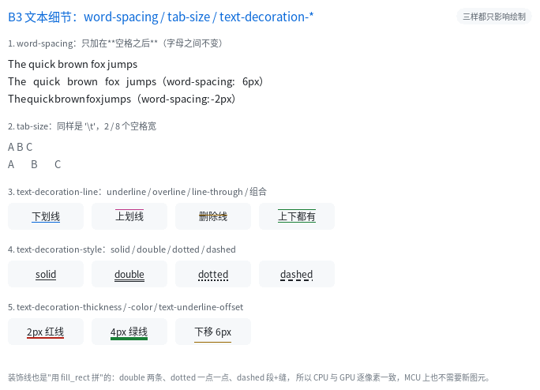

```css
.p  { word-spacing: 6px; }
pre { tab-size: 4; }
.u  { text-decoration: underline; text-decoration-thickness: 2px;
      text-decoration-color: #38BDF8; }
.s2 { text-decoration: underline; text-decoration-style: dotted; }
.o  { text-decoration: overline; }
.d  { text-underline-offset: 6px; }
```

装饰线的四种形态都是 `fill_rect` 拼出来的，所以两条后端逐像素一致。

## 13. `28_bg_image`：背景图与 size / position / repeat

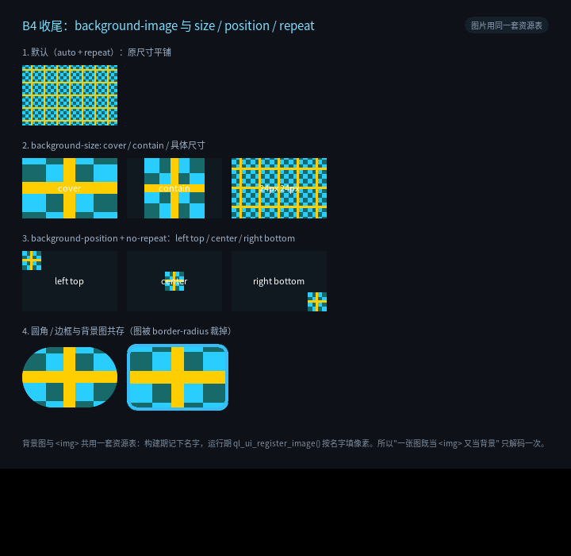

```css
.tile    { background-image: url(checker); }
.cover   { background-size: cover; }
.contain { background-size: contain; background-repeat: no-repeat; }
.px      { background-size: 24px 24px; }
.pr      { background-size: 24px 24px; background-repeat: no-repeat;
           background-position: right bottom; }
.round   { background-size: cover; border-radius: 38px; }
```

资源与 `` 共用一张表：`ql_ui_register_image("checker", ...)` 填一次像素，
背景与 `` 都能用。

## 14. `29_grid`：二维布局

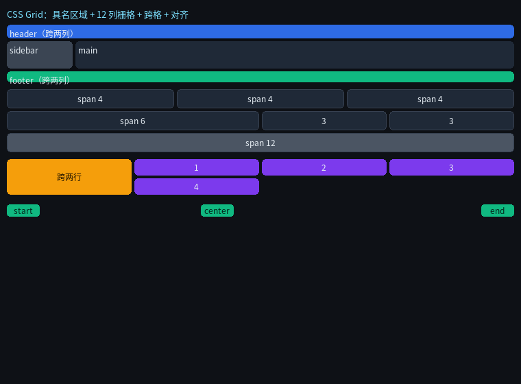

```css
.page   { display: grid; grid-template-areas: "hd hd" "sb mn" "ft ft";
          grid-template-columns: 96px 1fr; gap: 4px; }
.hd     { grid-area: hd; }
.cards  { display: grid; grid-template-columns: repeat(12, 1fr); gap: 4px; }
.c4     { grid-column: span 4; }
.full   { grid-column: 1 / -1; }
.tall   { grid-row: span 2; }
.mix    { grid-template-columns: minmax(60px, auto) 1fr 25%;
          justify-items: center; }
```

一行 CSS 就是一屏页面骨架；12 列栅格按份数拼；`span 2` 让瓦片跨行。

## 15. `30_border_image`：一张九宫格图当边框

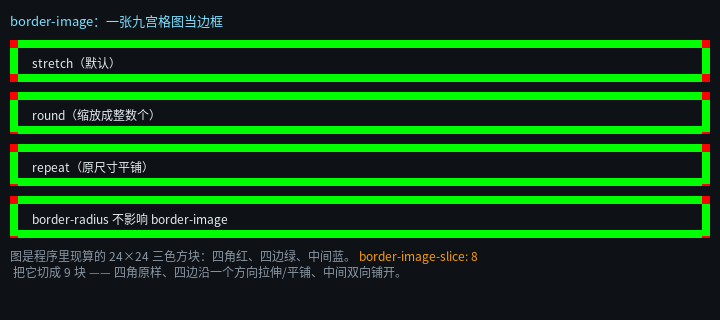

```css
.box { border-width: 10px; border-style: solid;
       border-image: url(frame) 8; }
.repeat { border-image-repeat: repeat; }
.round  { border-image-repeat: round; }
```

四角不变形、四边沿一个方向铺开 —— 这是"像素风 / 描边卡片"最常见的做法。

## 16. 这几个例程查出了什么

写完这三个例程当场暴露了一个真 bug：

- `::before` 配宿主文本时，两边都从内容盒原点开始排 —— 圆点被正文盖掉，
  `::after` 的引号同理。修法是把宿主文本挪进匿名 `span`（与混排同一份实现），
  并让这个匿名节点**不参与** `:first-child` / `+` / `~` 的匹配与计数。
  回归测试：`test/web/test_pseudo_text.c`。
- 顺带修掉 `expand_pseudo` 里两处隐患：一条会漏内存的占位语句，
  以及规则表 `realloc` 之后继续用旧 `Rule *` 的悬垂指针。

这就是"把每个效果都摆出来"的价值 —— 单看每个特性的单元测试都绿，
放到同一张图里才看得出**它们之间的相互作用**。
