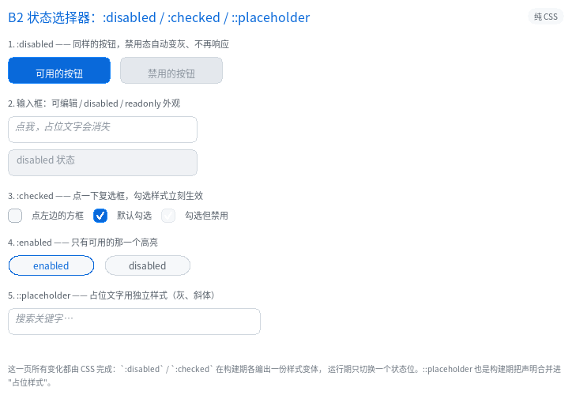
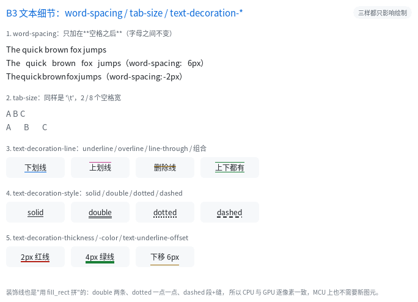
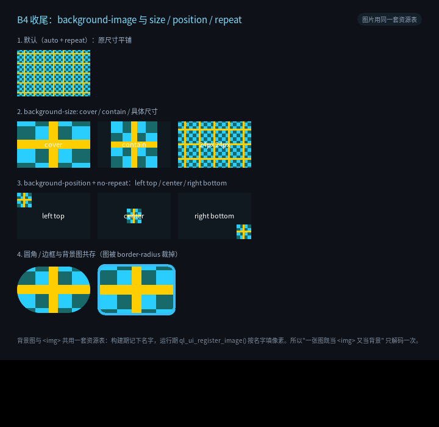

# CSS3 补全收官：状态选择器、文本细节、背景图

五批计划（B1–B5）走到这一篇就收尾了。前面几篇分别讲过单位与尺寸
（[CSS 效果检阅](16_css_gallery.html)）、选择器与 `::before`
（[CSS3 补全](14_css3.html)）、绘制细节（[CSS 效果检阅](16_css_gallery.html) 与
`example/25_b4`）、布局与交互（`example/24_b5`）；这一篇补齐最后三块，
并说明**为什么 `filter: blur()` 还没做**。

| 批 | 这一篇补的 | 例程 |
|---|---|---|
| B2 | `:disabled` / `:enabled` / `:checked` / `::placeholder`（含复选框控件） | `26_css_states` |
| B3 | `word-spacing` / `tab-size` / `text-decoration-*`（line/style/color/thickness/underline-offset） | `27_css_text2` |
| B4 | `background-image: url()` + `background-size` / `-position` / `-repeat` | `28_bg_image` |

---

## 1. 状态选择器（B2）

三个伪类的共同点：**在构建期就编好另一份样式**，运行期只翻一个状态位。

```css
.btn:disabled { background-color: #2A3442; color: #6C7783; }
input:enabled { border-color: #2E6BE6; }
.cb:checked  { background-color: #2E6BE6; }
input::placeholder { color: #5E6B7A; font-style: italic; }
```

```html
<button disabled>禁用的按钮</button>
<input type="checkbox" checked>
<input type="text" placeholder="搜索关键字…">
```

实现要点：

- `disabled` / `checked` / `selected` 这些**属性**在建表期就变成节点标志位；
  `:disabled` 与 `:checked` 各编一份样式变体存在 `QLUINode` 里（与 `:hover` 同构）。
- 运行期状态优先级：`disabled > active > focus > checked > hover`。
  禁用元素不该再"悬停高亮"，所以它排最前。
- `:enabled` = "没有 disabled 属性"：建表期按节点属性决定要不要把这个位打开。
- **复选框**是顺带补上的最小控件：`<input type="checkbox">` 有自己的一套 UA 默认
  （16×16 方框、无内边距），点一下切换 `:checked`，勾选时画一个 √。
  它**不进输入框池**（没有文本可编辑），所以 MCU 上不占缓冲。
- `::placeholder` 不是生成内容的伪元素：构建期把 `input::placeholder` 的声明
  合并进宿主样式，单独存一份"占位样式"；输入框为空时用它画那句提示。

> 别忘了 `::placeholder` 的样式**继承宿主**（字号、字体都跟着输入框），
> 这正是我们要的行为：只改颜色/字形，不改排版。

---

## 2. 文本细节（B3）

```css
.p { word-spacing: 6px; }      /* 只加在空格之后，字母之间不变 */
pre { tab-size: 4; }           /* '\t' 折算成 4 个空格 */
a   { text-decoration: underline; text-decoration-color: #38BDF8;
      text-decoration-thickness: 2px; text-underline-offset: 3px; }
.d  { text-decoration: underline; text-decoration-style: dotted; }
.o  { text-decoration: overline; }     /* B3 新增 */
```

- `word-spacing` 加在**空格之后**（CSS 就是这么定义的），所以
  `word-spacing: -2px` 会把词挤在一起 —— 例程第 1 节能直接看出来。
- `tab-size` 在**构建期**把 `\t` 展开成 N 个空格（`white-space: pre` 系列才保留），
  运行期一个字符判断都没有。
- `text-decoration-*` 的形态（solid / double / dotted / dashed）、粗细、颜色、
  下划线偏移都是"用 `fill_rect` 拼"出来的：不需要新图元，CPU 与 GPU 逐像素一致。
  `text-decoration-line` 支持 `underline` / `line-through` / `overline` 及其组合。

---

## 3. 背景图（B4 收尾）

```css
.card { background-image: url(checker); background-size: cover; }
.icon { background-image: url(checker); background-size: 24px 24px;
        background-repeat: no-repeat; background-position: right bottom; }
```

- 资源与 `` **共用一张表**：构建期把名字记进文本池，
  运行期 `ql_ui_register_image()` 按名字填像素 —— 同一张图只解码一次。
- 几何计算复用 `object-fit` 那一套：`cover` / `contain` / `<w> <h>`；
  `background-position` 与 `object-position` 同式（百分比在"多出来的余量"里算）。
- 平铺时先把起点对齐到可见瓦片，再把裁剪设成边框盒 —— 否则会画到兄弟节点上。
- 背景图铺在**背景色之上、边框之下**，圆角由 `border-radius` 裁（走图片自己的 SDF）。

---

## 4. 为什么 `filter: blur()` 还没做

五批清单里 B4 还留着 `filter` 一项。这一项的成本与前四项不是一个量级：

| 函数 | 需要什么 | 结论 |
|---|---|---|
| `brightness/contrast/saturate/grayscale/sepia/invert/hue-rotate` | 逐图元颜色矩阵（CPU 改混合路径、GPU 加 uniform） | 可以做，但等于给每条绘制入口加一次矩阵 |
| `blur()` / `drop-shadow()` | **离屏图层**：子树的绘制结果要先合成到一张图，再整体模糊 | 与 `transform: rotate()` 同级的新子系统 |
| `backdrop-filter` | —— | 已有（`15_backdrop`） |

所以这一轮先把"真实页面里出现频率高得多"的三块做完，`filter` 与
`transform: rotate()` 一起留作单独立项。覆盖表里如实标 ⏳，不假装支持。

---

## 5. 三条例程怎么跑

```bash
./build/example/example_26_css_states      # 点复选框 / 试 disabled 输入框
./build/example/example_27_css_text2       # 看 word-spacing / tab-size / 装饰线
./build/example/example_28_bg_image        # 看 cover/contain/position/repeat
```

三页都是纯 CSS：没有任何运行期样式匹配，也没有一行 JS。







---

## 6. 这一轮的验收

| 项 | 数字 |
|---|---|
| 新增测试 | `test_m8`（61 项：状态/文字/背景逐点取色 + 7 条非法值必须报错） |
| blob | v26 → **v27**（`QLUIStyle` 240 → 272，`QLUINode` 20 → 28） |
| golden | 29 页全部重生成，图像逐像素未变（只改了结构体布局） |
| 三套构建 | 普通 / strict / ASan 各 74/74 |
