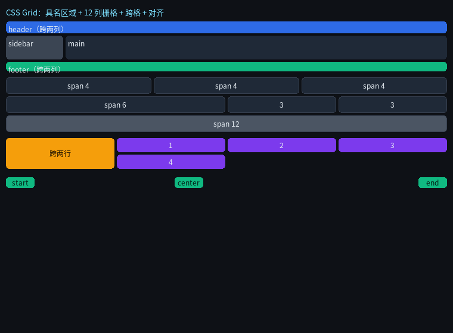
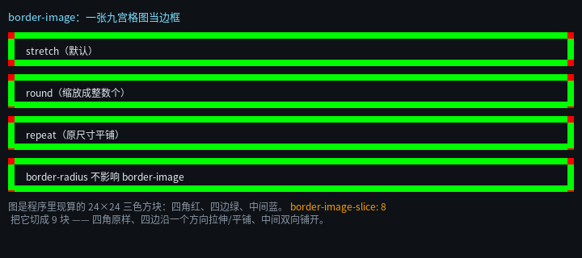

# Grid：二维布局，以及 `border-image`



完整程序：`example/29_grid/` 与 `example/30_border_image/`

前面所有布局都是**一维**的：block 从上往下堆，flex 沿一条主轴排。表格状的界面
（卡片墙、后台管理页、"页头 / 侧栏 / 正文 / 页脚"）用一维工具拼要套好几层
wrapper —— 而包一层就多一次布局，实测**一层 wrapper ≈ 3 个叶子节点的代价**。

Grid 是二维的：一次定好列轨道和行轨道，然后把子项"放到格子里"。

```css
.g { display: grid; grid-template-columns: repeat(3, 1fr); gap: 8px; }
```

---

## 1. 轨道：`fr` 是"剩下的按份数分"

```css
.a { grid-template-columns: 100px 1fr 2fr; }   /* 定长 + 两份，共 3 份 */
.b { grid-template-columns: 25% 1fr; }         /* 百分比相对容器内容宽 */
.c { grid-template-columns: repeat(4, 1fr); }  /* 4 等分 */
.d { grid-template-columns: minmax(60px, auto) 1fr; }  /* 至少 60，能大则大 */
```

分配顺序是**先满足下限、再分剩余**：

1. 每条轨道先拿到自己的 `min`（`px` / `%` 直接算，`auto` 先记 0）；
2. `max` 是定长的（`minmax` 的上限）→ 取满；
3. `max` 是 `auto` → 取这一列里子项的**最大内容宽**；
4. `max` 是 `fr` → 把剩下的空间按 `fr` 权重分。

`fr` 的份额是**累计推进**的，所以 `1fr 1fr 1fr` 在 100px 里是 33+34+33 ——
三个盒子加起来正好 100，右边界不会差 1 像素。

> `min-content` / `max-content` 关键字目前按 `auto` 处理（差异只在"内容比轨道宽"时可见）。

---

## 2. 摆放：三种写法

```css
/* ① 自动放置：从左到右、排满换行 */
.item { }

/* ② 线号（1 开始的网格线），可跨格 */
.wide { grid-column: 1 / span 2; }     /* 从第 1 条线起，跨 2 格 */
.tall { grid-row: span 2; }            /* 行号自动，跨 2 行 */
.last { grid-column: -2 / -1; }        /* 负号从末尾数：-1 = 最后一条线 */

/* ③ 具名区域：一屏写完页面骨架 */
.page {
  display: grid;
  grid-template-areas:
    "hd hd"
    "sb mn"
    "ft ft";
  grid-template-columns: 96px 1fr;
  grid-template-rows: 20px 1fr 16px;
}
.hd { grid-area: hd; }   /* 自动拿到 2 列宽 */
.sb { grid-area: sb; }
.mn { grid-area: mn; }
.ft { grid-area: ft; }
```

具名区域的语法是"用引号画一张字符地图"：同名的一组格子**必须是矩形**，
不然构建期就报错（`区域名 'a' 在 grid-template-areas 里不是矩形`）。

自动放置的规则（与浏览器一致）：

| 子项 | 行为 |
|---|---|
| 行列都没写 | 从游标往后找第一个放得下的空位，排满换行 |
| 只写了列 | 在这一列里往下找第一个空位 |
| 只写了行 | 在这一行里往右找第一个空位 |
| 行列都写了 | 直接放，并且把游标推到它后面 |

`grid-auto-flow: row dense` 会把游标倒回原点找洞（适合"大小不一的瓦片"）。

---

## 3. 对齐：格子里的盒子怎么摆

```css
.g { justify-items: center; align-items: end; }   /* 容器级：横向居中、纵向贴底 */
.item { justify-self: start; }                     /* 单个覆盖 */
```

默认两个方向都是 `stretch` —— 子项**撑满整个格子**（这就是"卡片自动等宽"的来源）。
写 `width` / `height` 之后才不撑满，此时 `justify-self` / `align-self` 决定位置。

矩阵式记法（和 flex 一样）：

| | 横向（列） | 纵向（行） |
|---|---|---|
| 容器 | `justify-items` | `align-items` |
| 子项 | `justify-self` | `align-self` |

`place-items` / `place-self` 是"纵向 + 横向"的简写（本库只取第一个词）。

---

## 4. 隐式轨道：多出来的行

只写了列没写行时，多出来的子项会落在**隐式行**上，高度由内容决定。
想控制它们：

```css
.g { grid-auto-rows: 30px; }      /* 隐式行一律 30 高 */
```

同理 `grid-auto-columns` 管隐式列（子项写了超出模板的列号时会用到）。

---

## 5. `border-image`：一张图当边框



```css
.box {
  border-width: 10px;
  border-style: solid;
  border-image: url(frame) 8;          /* 源图 + 切片 */
  border-image-repeat: round;          /* stretch（默认）/ repeat / round / space */
}
```

九宫格的做法：把源图按 `slice` 切成 9 块 ——

```
┌────┬──────────┬────┐
│ 角 │    边    │ 角 │   角：原样缩放
├────┼──────────┼────┤   边：沿一个方向拉伸 / 平铺
│ 边 │    中间  │ 边 │   中间：双向铺开（源图那儿透明就透出来）
├────┼──────────┼────┤
│ 角 │    边    │ 角 │
└────┴──────────┴────┘
```

三个要点：

1. **切片是源图上的像素**（或百分比），画出来的宽度由 `border-width` /
   `border-image-width` 决定；
2. 写了 `border-image` 就**不再画 `border-style`**（颜色/线型被顶掉，宽度还在）；
3. `border-radius` 不会让边框图跟着拐弯 —— 这与 CSS 的行为一致。

图片来源与 `` / `background-image` 完全相同（`ql_ui_register_image()` 按名字填像素）：

```c
QLUIImageInput in = { 0 };
in.name = "frame";
in.data = (const uint8_t *)rgba_pixels;
in.len = sizeof(rgba_pixels);
in.w = in.h = 24;
in.format = QL_IMAGE_SRC_RAW;
in.pixel_format = QL_IMAGE_RGBA8888;
ql_ui_register_image(ui, &in);
```

---

## 6. 什么时候该用 Grid

| 想做的事 | 用什么 |
|---|---|
| 一行几个、等宽排列、排满换行 | **flex + `flex-wrap: wrap`** 就够，Grid 也行 |
| 列宽要**相互对齐**（卡片墙 / 表单标签列） | **Grid**（flex 做不到"第 3 张和第 6 张左边对齐"） |
| "页头 / 侧栏 / 正文 / 页脚" | **Grid 具名区域**（一行 CSS 说清结构） |
| 某个元素跨两行且高度由两行决定 | **Grid `grid-row: span 2`** |
| 一维菜单、工具栏、按钮组 | **flex**（更省事） |

> **性能上的反直觉**：Grid 不但不比"嵌套 flex 拼网格"慢，反而更快。
> 240×160 的 3×3 卡片在 MCU 上实测：嵌套 flex 0.427 ms、Grid 0.229 ms（**−46%**），
> 因为省掉了 wrapper 层。数据见[性能诊断](../tutorial/17_perf.html)。

---

## 7. 还不支持的（会报错，不会静默）

| 写法 | 报错 | 替代 |
|---|---|---|
| `grid-auto-flow: column` | 暂不支持 | 用 `row`，或把行列手动换过来 |
| `grid-template-columns: [name] 1fr` | 不支持具名网格线 | 用 `grid-template-areas` 的具名区域 |
| `repeat(auto-fill, …)` | 显式轨道数必须能算出来 | 用固定份数 + `flex-wrap` |
| `grid: 1fr 1fr` / `grid-template: …` | 不支持简写 | 分开写长写 |
| `border-image-outset` | 边框图不向外扩 | |

完整清单见 [CSS3 覆盖与裁剪](../manual/ui/CSS3覆盖与裁剪.html) §11 / §19.1。

---

上一章：[`calc()` 与布局期算术](16_css_gallery.html) ｜ 下一章：[性能诊断与 MCU 基准](17_perf.html)
