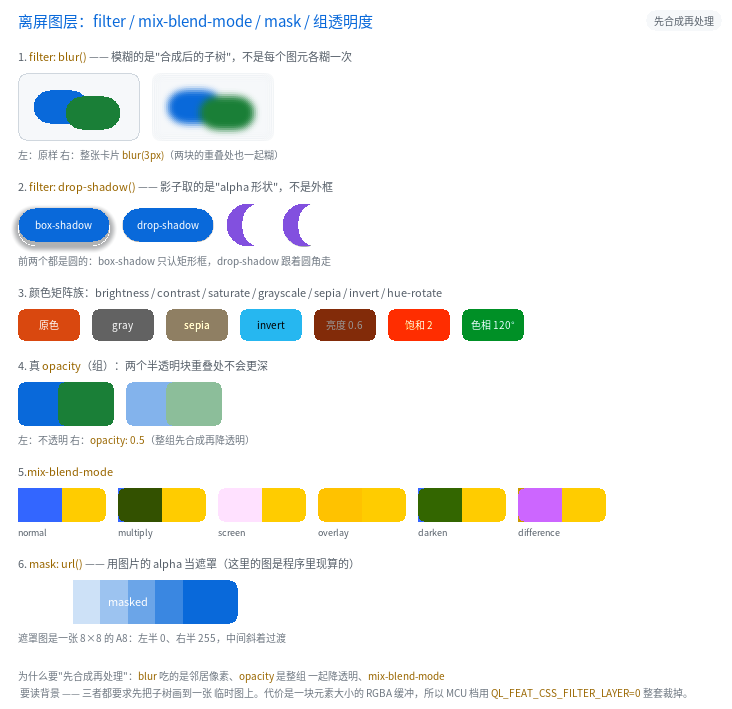

# 离屏图层：`filter` / `mix-blend-mode` / `mask` / 组透明度



完整程序：`example/31_filter/`

前面所有绘制都是"**一个图元画一次**"：背景一块、边框一圈、文字一遍。这条规矩
简单、快，而且 MCU 上不需要任何额外内存。但它表达不了四类效果：

| 想要 | 为什么一图元一次做不到 |
|---|---|
| `filter: blur(4px)` | 模糊要读**邻居像素** —— 一个元素内部的图元得先落在一起，否则每块各糊一次，接缝处会亮一条线 |
| `opacity: 0.5` 的**组** | 逐图元乘 alpha 时，子元素**重叠的地方会叠两次**，比别处更暗 |
| `mix-blend-mode` | 混合要读**背景像素**（它自己画之前那块地方） |
| `mask: url()` | 遮罩要乘在"整个元素合成后的 alpha"上 |

四样东西的共同前提是一句话：**先把这棵子树合成到一张临时图上，再整体处理。**
这就是"离屏图层"。

```css
.card { filter: blur(3px) drop-shadow(0 4px 4px rgba(0,0,0,.45)); }
.group { opacity: 0.5; }
.blend { mix-blend-mode: multiply; }
.masked { mask: url(alpha8); }
```

---

## 1. 什么时候会自动开图层

不是所有元素都要图层。判据写在 `src/ui/qlui.c` 的 `style_needs_layer()`：

| 条件 | 是否开图层 |
|---|---|
| 写了 `filter`（任何函数） | 开 |
| `mix-blend-mode` 不是 `normal` | 开 |
| `mask` 不是 `none` | 开 |
| `opacity < 1` **且有子节点** | 开（单节点的逐图元乘 alpha 与合成等价） |
| 其余（99% 的元素） | 不开，走原来的单批次路径 |

最后一行很重要：**图层是要花内存和带宽的**，所以它必须"按需、稀有"。

---

## 2. `filter`

### 2.1 支持哪些函数

| 函数 | 参数 | 说明 |
|---|---|---|
| `blur(<N>px)` | 0~64 | 9 抽头可分离高斯，抽头间距 = N/2 |
| `brightness(<倍数>\|<百分比>)` | 0~100 倍 | `1.2` 与 `120%` 等价 |
| `contrast(...)` | 同上 | `c' = (c-0.5)*k+0.5` |
| `saturate(...)` | 同上 | 标准饱和度矩阵 |
| `grayscale(...)` / `sepia(...)` / `invert(...)` | 0~100% | 按比例在"原色"与"效果色"之间插值 |
| `hue-rotate(<N>deg)` | 0~360 | CSS 的固定旋转矩阵（不是 HSL 往返） |
| `opacity(<0~1>)` | — | 乘在图层 alpha 上 |
| `drop-shadow(<dx> <dy> [<blur>] [<color>])` | — | 影子取 **alpha 形状**，跟着圆角走 |

不支持 `url(#svg)`、`spread`（第 4 个长度值）—— 都会**构建期报错**。

```css
.a { filter: blur(4px); }
.b { filter: brightness(120%) saturate(1.5); }    /* 链式，顺序即应用顺序 */
.c { filter: drop-shadow(2px 3px 4px #123456); }
```

### 2.2 `drop-shadow` 与 `box-shadow` 的区别

这是最容易搞混的一点：

```html
<div class="moon"></div>   <!-- 圆角做出来的月牙 -->
```

- `box-shadow` 认的是**边框盒**：月牙的影子是一个矩形框的影子；
- `drop-shadow` 认的是**合成后的 alpha**：影子是月牙形状。

前者的代价是一次边缘扫描，后者要先把元素画出来再抽 alpha，所以后者一定带图层。

---

## 3. 组 `opacity`

```css
.group { opacity: 0.5; }
```

老语义（现在是"单节点"的情形）：把 `opacity` 乘进每个图元的 alpha。
新语义（有子节点时）：整组先合成，再乘。

差别只在**重叠处**：

```
两个半透明块重叠             逐图元乘 alpha        组 opacity
  ██▒▒██                   重叠处 = 0.5+0.5*0.5    重叠处 = 0.5
```

`example/31_filter` 的第 4 节就是这个对照 —— 右边两块重叠的地方**不比别处深**。

---

## 4. `mix-blend-mode`

做了浏览器里最常用的七个：`normal` / `multiply` / `screen` / `overlay` /
`darken` / `lighten` / `difference`。其余（`hue` / `color` / `exclusion` …）
**构建期报错**。

```css
.bl { background-color: #3366FF; mix-blend-mode: multiply; }
```

公式（`cb` = 背景、`cs` = 源，都是 0..1）：

| 模式 | 结果 |
|---|---|
| `multiply` | `cb * cs` |
| `screen` | `cb + cs - cb*cs` |
| `overlay` | `cb < 0.5 ? 2*cb*cs : 1-2*(1-cb)*(1-cs)` |
| `darken` / `lighten` | `min` / `max` |
| `difference` | `abs(cb - cs)` |

> 混合模式读的是**背景**，所以 GPU 侧要把目标表面那一块先抓成一张纹理再算
> （和毛玻璃同一个套路）。

---

## 5. `mask`

```css
.masked { mask: url(alpha8); }
```

- 只用图片的 **alpha**（`A8` 直接取灰度，`RGBA8888` 取 alpha 通道）；
- 遮罩被**拉伸到边框盒**（相当于 `mask-size: 100% 100%` + `mask-mode: alpha`）；
- `mask: none` 表示取消。

`mask-image` / `mask` 两个写法都行。`mask-position` / `mask-repeat` /
`mask-composite` 还没做，写了会报错。

---

## 6. 代价：一块元素大小的缓冲

| 项 | 数字 |
|---|---|
| 每层缓冲 | `宽 × 高 × 4` 字节（预乘 RGBA） |
| 最多嵌套 | `QL_CFG_UI_LAYER_MAX_DEPTH`（默认 4） |
| 单个图层上限 | 4096×1024（防误用，超了按上限截） |
| 编译期开关 | `QL_FEAT_CSS_FILTER_LAYER`（MCU 默认关） |

关掉之后 `filter` / `mix-blend-mode` / `mask` 在**构建期报错**（红线：不静默降级），
`opacity` 退回逐图元乘 alpha 的老语义。

CPU 侧的图层用"**两遍哑光反解**"：同一棵子树画两遍（黑底、白底），再解方程

```
黑底：B = C·a          白底：W = C·a + 255·(1-a)
⇒  a = 255-(W-B)，预乘色就是 B
```

GPU 侧有真的 RGBA 帧缓冲，只画一遍。两条后端的结果用
`test_gl_vs_cpu` 的图层用例逐像素对拍（差异 < 0.01%）。

---

## 7. 常见坑

1. **`text-align` / `border-radius` 与滤镜的关系**：图层外扩了模糊半径那一圈，
   但**裁剪仍然按边框盒**（含圆角）。所以"圆角卡片 + 模糊光晕"的四个角是干净的 ——
   这也是 `layer_fx_of()` 里把 `box` 和 `corner` 一起传给后端的原因。
2. **`drop-shadow` 的颜色默认取 `currentColor`**（也就是元素的 `color`），
   不写颜色时影子是文字色，不是黑色。
3. **`filter` 里的 `blur` 与 `backdrop-filter` 不是一回事**：前者糊自己，
   后者糊"自己背后已经画好的东西"。后者不需要图层（就地模糊即可）。
4. **图层会打断 GPU 的"单批次"**：一个带滤镜的元素至少多一次 flush + 一次合成。
   所以别给滚动列表的每一行都加 filter。
