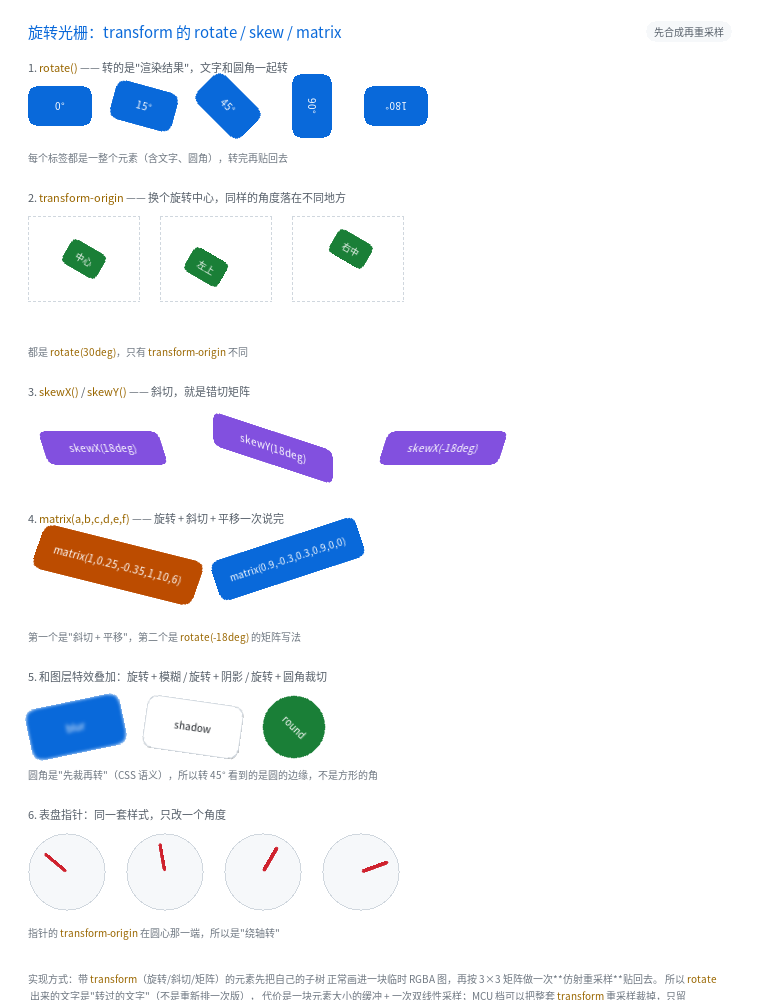

# 旋转光栅：`transform: rotate()` / `skew()` / `matrix()`



完整程序：`example/32_transform/`

到目前为止，`transform` 只做了两件事：`translate()`（加到绘制偏移上）和
`scale()`（绘制期绕中心缩放）。它们都是"画的时候顺手改一下坐标"，
一个图元画一次，零内存、零重采样。

`rotate()` / `skew()` / `matrix()` 不一样：**它们转的是"已经画好的像素"**。

```css
.badge { transform: rotate(15deg); }
```

这行 CSS 在浏览器里意味着：先把 `.badge` 整个（背景、圆角、边框、文字、
子元素、滤镜结果）画成一张图，再把这张图**转过去**贴回来。所以

- 转过的文字是"**转过的文字**"，不是重新排版一次（字距、折行都不变）；
- 圆角转完还是圆的（不是转出一个方角）；
- `filter: blur()` 的结果跟着一起转（而不是转完再糊一次）。

---

## 1. 为什么必须"先合成再转"

另一条路是"把每个图元按矩阵画一遍"（矩形转成四边形、文字逐字转）。
听起来省一块缓冲，实际全是坑：

| 逐图元转 | 结果 |
|---|---|
| 文字 | 每个字形单独转，笔画的抗锯齿错位 → 看起来像**马赛克**；行距、字距也不再遵循排版 |
| 圆角 / 阴影 | 圆角矩形转成"旋转后的四边形 + 原来的圆角半径" → 形状明显变形 |
| `filter` / `mask` / 组 `opacity` | 这些效果本身要求"先合成"，逐图元转会把它们拆散 |

所以实现直接复用上一章的**离屏图层**：`style_needs_layer()` 里加一条
"有 `xform` 就要图层"，剩下的重采样在合成阶段做一次。

> 也就是说：`transform` 的旋转能力**挂在离屏图层包上**。
> 把 `QL_FEAT_CSS_FILTER_LAYER` 裁掉之后，写 `rotate()` 会在**构建期报错**
> （不是悄悄不转 —— 那是最难查的一类问题）。

---

## 2. 支持哪些写法

| 写法 | 说明 |
|---|---|
| `rotate(<角度>)` | 顺时针为正；`deg` 单位 |
| `skew(<ax>[, <ay>])` / `skewX()` / `skewY()` | 错切（正方形变平行四边形） |
| `matrix(a,b,c,d,e,f)` | 2×3 矩阵，一次说完"线性部分 + 平移" |
| `translate()` / `scale()` 与上面混写 | 一整串乘成**一个**矩阵（CSS 语义） |
| `transform-origin` | `px` / 百分比 / `left` `center` `right` `top` `bottom`；默认元素中心 |

不支持的（会报错，不会静默忽略）：`perspective()`、`rotate3d()`、`matrix3d()` ——
它们要真 3D 管线（透视除法 + 深度排序），归"不排期"。

```css
.a { transform: rotate(30deg); }
.b { transform: rotate(90deg); transform-origin: left top; }   /* 绕左上角转 */
.c { transform: skewX(18deg); }
.d { transform: matrix(1, 0.25, -0.35, 1, 10, 6); }            /* 斜切 + 平移 */
.e { transform: translate(10px, 4px) rotate(12deg) scale(1.1); } /* 乘成一个矩阵 */
```

---

## 3. `transform-origin` 决定"绕哪根轴转"

默认是**元素中心**（`50% 50%`）。换成 `left top`，同一个角度会落到完全不同的位置：

```css
.needle { width: 40px; height: 28px; transform: rotate(30deg); }
.o-center   { transform-origin: 50% 50%; }
.o-topleft  { transform-origin: left top; }
.o-right    { transform-origin: right center; }
```

百分比是相对**元素自己的边框盒**算的。例程第 6 节的表盘指针就是这么做的：
指针的 origin 放在"圆心那一端"，于是 `rotate()` 变成"绕轴转"。

---

## 4. 和图层特效叠加

因为旋转发生在合成阶段，顺序天然是 CSS 的语义：

```
子树（含 filter / opacity / mask）→ 合成  → 旋转重采样 → 贴回页面
```

于是下面三种写法都"看着对"：

```css
.blur-rot   { transform: rotate(-12deg); filter: blur(2px); }      /* 先糊再转 */
.shadow-rot { transform: rotate(8deg);  filter: drop-shadow(3px 4px 3px #0006); }
.round-rot  { transform: rotate(45deg); border-radius: 32px; }     /* 先裁再转 */
```

`.round-rot` 那个最容易验：64×64 的方块加 32px 圆角就是**圆**，
转 45° 之后看到的仍然是圆的边缘。如果实现是"先转再裁"，会立刻露出方角。

---

## 5. 命中测试也转了

旋转只影响**绘制**，不改变布局盒（`getBoundingClientRect` 在浏览器里也是原盒）。
所以点中测试要把屏幕点按矩阵**逆变换**回局部空间再判：

```
点 → M⁻¹ → 元素未旋转时的坐标 → 原来的盒判断
```

嵌套旋转也没问题：每个节点的逆变换都在**它自己的局部空间**里做，
逐层下降正好是仿射矩阵的连乘。

```c
/* test_transform.c 里钉住这一条 */
ql_ui_hit_test(ui, 80, 45);   /* 转了 90° 的竖条上 → 命中 */
ql_ui_hit_test(ui, 65, 60);   /* 原来的横条位置 → 命中不到它 */
```

---

## 6. 代价

| 项 | 值 |
|---|---|
| 每样式的额外体积 | +8 B（矩阵下标 + 两个原点长度） |
| 矩阵存哪 | 文档里的**矩阵池**（26.6 定点，同值去重，上限 32） |
| 运行期内存 | 与离屏图层相同：元素盒大小的 RGBA 缓冲 |
| 编译期开关 | `QL_FEAT_CSS_FILTER_LAYER`（MCU 默认关） |
| MCU 实测 | 解析 + 矩阵运算只要 **804 B**；图层合成慢路 **3,488 B** |

**别给滚动列表的每一行都加 `rotate()`** —— 每行一个图层，等于每行多一次
"合成 + 重采样"。旋转适合做徽章、贴纸、表盘、卡片倾斜这类少量装饰。

---

## 7. 常见坑

1. **元素转出父容器就被裁了**。旋转不改变布局，父级的 `overflow: hidden`
   仍然按**原盒**裁。给旋转的元素留点内边距，或者让父级 `overflow: visible`。
2. **重采样会多出约 1 px 边缘**。越界采样点走"边缘钳位"，所以旋转/平移后的
   元素外沿会带一圈边缘色。CPU/GPU 一致，肉眼不可见 —— 但写像素断言时要算上。
3. **`scale()` 与 `rotate()` 一起写**时整串进矩阵（不再走"绘制期缩放"那条快路），
   所以会**开图层**。只写 `scale()` 则仍然零重采样。
4. **`@keyframes` 里不能写 `rotate()`**（关键帧只存 `translate`/`scale` 的整数值）。
   需要转起来的动画请用 JS 改样式，或改用 `scale()` 做"假翻转"。
5. **`transform-origin` 的百分比是相对边框盒的**，不是相对内容盒 ——
   带 `padding` 时两者不同。

---

上一章：[离屏图层：`filter` / `mix-blend-mode` / `mask`](20_filter.html) ｜
下一章：[性能诊断与 MCU 基准](17_perf.html)
