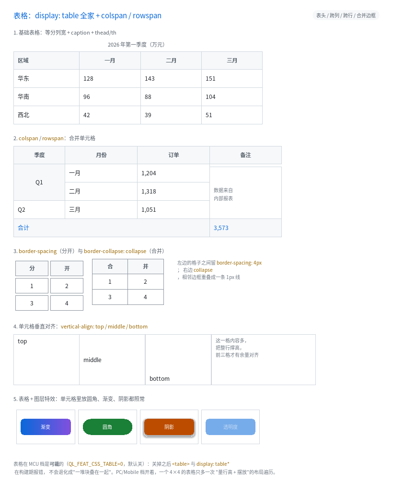

# 表格：`display: table` 全家 + `colspan` / `rowspan`



完整程序：`example/33_table/`

在这之前，想画一个表格只能拿嵌套的 `flex` 拼：一行一个容器、每个格子固定宽度，
表头、跨行、跨列全得手算。B7 把真正的表格做进来了：

```html
<table>
  <caption>一季度</caption>
  <thead><tr><th>区域</th><th>一月</th></tr></thead>
  <tbody><tr><td>华东</td><td>128</td></tr></tbody>
</table>
```

```css
table { width: 520px; border-collapse: collapse; }
th, td { border: 1px solid #D0D7DE; padding: 5px 8px; vertical-align: middle; }
```

---

## 1. 结构：只有"单元格"有盒子

浏览器里表格是**两套 display 交叉**的结构：

```
table           ← 表格本身（有盒子）
 ├ caption      ← 表格标题（有盒子，排在表格上方）
 ├ thead        ← 行组（**没有盒子**，只是分组）
 │   └ tr       ← 行（**没有自己的内容盒**，只是分组）
 │       └ td   ← 单元格（真正的盒子：有背景、边框、内边距）
```

本库照这个模型实现，所以有一条重要推论：**样式要写在 `td` / `th` 上**，
写在 `tr` / `thead` 上不会有边框和背景（和浏览器一样）。

| HTML 标签 | `display` |
|---|---|
| `<table>` | `table` |
| `<caption>` | `table-caption` |
| `<thead>` / `<tbody>` / `<tfoot>` | `table-row-group` |
| `<tr>` | `table-row` |
| `<td>` | `table-cell` |
| `<th>` | `table-cell` + 加粗 + 居中 |
| `<colgroup>` / `<col>` | `table-column` / `table-column-group`（只提供列宽，不产生盒子；见 §6） |

也可以不写标签，直接用 CSS 的 `display: table / table-row / table-cell` 拼。

---

## 2. 列宽怎么定：`fixed` 与 `auto`

`table-layout: fixed`（快、可预测）与 `auto`（按内容自适应）都支持：

- **fixed**：列宽由**第一行的 `width`**（或 `<col>`）决定，余量按各列宽度**比例**摊回；
- **auto**：先量每列的 `min-content` / `max-content`，再在 `[floor, pref]` 之间插值。

下面先看 fixed：

1. **首行**里显式写了 `width` 的单列单元格 → 这一列就是那个宽度；
2. 其余列**等分**剩下的宽度（余数给右边那几列）；
3. 表格宽度取 `width`（没写就是父容器的可用宽度）。

```css
table { width: 520px }        /* 4 列 → 每列 130px */
.w1   { width: 120px }        /* 第一列 120px，其余 3 列平分 400 → 133/133/134 */
```

为什么先做 fixed：它**只排一遍**，而 auto 要先量每列的 `min/max-content` 再分配，
布局成本翻倍（那是下一步的事，覆盖表里如实标着）。

---

## 3. 跨行跨列：`colspan` / `rowspan`

```html
<tr><td rowspan="2">Q1</td><td>一月</td><td>1,204</td></tr>
<tr><td>二月</td><td>1,318</td></tr>
<tr><td colspan="3">合计</td><td>3,573</td></tr>
```

- `colspan="N"`：这个单元格占 N 列的宽度（含中间的列间距）；
- `rowspan="N"`：占 N 行的高度。**下一行会少一个格子**，后面的单元格自动右移 ——
  这靠一个"每列还被占几行"的小计数器实现（24 字节，与行数无关）。
- 跨行单元格的内容比这几行加起来还高时，**差额补给覆盖的最后一行**（与浏览器一致）。

属性值只认十进制整数；写 `colspan="abc"` 按 1 处理（浏览器也是这么做的）。

---

## 4. 间距与边框：`border-spacing` vs `border-collapse`

| 写法 | 效果 |
|---|---|
| `border-collapse: separate`（默认） | 每个单元格是独立盒子，格子之间留 `border-spacing` 的缝 |
| `border-collapse: collapse` | 相邻边框**重叠成一条**，不留缝 |

```css
.sep { border-spacing: 4px }              /* 横竖各 4px（也可以写两个值：横 竖） */
.col { border-collapse: collapse }        /* 共享边只有 1px */
```

`collapse` 的做法很直接：把单元格朝左上挪"自己那半条边框"，同时把尺寸补回同样的量。
于是两个相邻单元格的边框落在同一像素上（不是两条线），而右/下边缘仍落在网格线上。

---

## 5. 单元格垂直对齐

```css
td { height: 60px }
.va-top { vertical-align: top }
.va-mid { vertical-align: middle }   /* 表格单元格的浏览器默认值 */
.va-bot { vertical-align: bottom }
```

行高由这一行里**最高的单元格**决定，矮的单元格再把内容按 `vertical-align` 摆：
`middle` 居中、`bottom` 靠底、`top`（默认）贴顶。

> 注意：`vertical-align` 在**非表格**元素上仍然只认 `baseline` / `sub` / `super`
> （那是行内对齐，属于行内格式化上下文，本库还没有）。

---

## 6. 明确不做的（诚实清单）

| 项 | 现状 |
|---|---|
| `table-layout: auto` | ✅ 已支持（先量 min/max-content，再在 `[floor, pref]` 之间插值） |
| `colgroup` / `col` 的列宽声明 | ✅ 已支持（fixed 下优先于首行；auto 下是那一列的下界） |
| `caption-side: bottom` | 标题恒在上方 |
| `table-header-group` 的"每页重复表头" | 没有分页，无所谓 |
| 跨行单元格内容超高时的"按比例分配" | 差额全给覆盖的最后一行 |
| `border-collapse` 的"半边边框相加" | 用重叠实现：前提是相邻单元格边框宽度相同（常见写法都满足） |

---

## 7. 代价与裁剪

| 项 | 值 |
|---|---|
| 每节点额外体积 | `colspan` / `rowspan` 各 1 字节（`QLUINode` 28 → 30） |
| 每样式额外体积 | 4 个字段共 8 字节（`QLUIStyle` 344 → 352） |
| 布局 | 每个单元格多排一遍（量行高 + 定位），跨行单元格再多一遍 |
| 编译开关 | `QL_FEAT_CSS_TABLE`（**MCU 默认关**） |
| 裁掉之后 | `<table>` 与 `display: table*` **构建期报错**，不退化成"一堆块叠在一起" |

**不要用表格做整页布局**：`<table>` 的定位/浮动语义与 block 流不同，
整页布局请用 flex / grid；表格只用来显示**二维数据**。

---

## 8. 常见坑

1. **样式写在 `tr` / `thead` 上没效果** —— 它们不是盒子。边框、背景、内边距都写
   `td` / `th`。
2. **`width` 只认首行**（fixed 语义）。第二行写 `width` 不会改列宽。
3. **`border-spacing` 不接受百分比**（CSS 也不允许），只接受 px。
4. **单元格里的 `<br>` 与折行**：`white-space: normal` + 固定列宽就会折行；
   默认 `nowrap` 会撑出格子（被裁掉），这是本库文本模型的既定行为。
5. **`th` 默认加粗居中** —— 这是 UA 默认值，要改就自己写 `font-weight` / `text-align`。

---

上一章：[旋转光栅：`transform: rotate()` / `skew()` / `matrix()`](21_transform.html) ｜
下一章：[性能诊断与 MCU 基准](17_perf.html)
