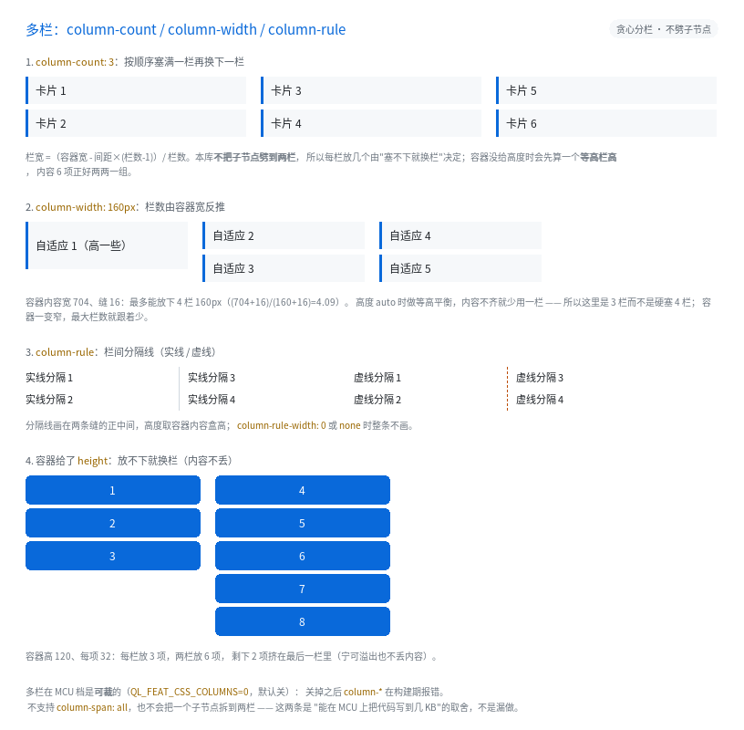

# 多栏：`column-count` / `column-width` / `column-rule`



完整程序：`example/34_columns/`

一页要放"很多张小卡片"，最省事的不是 `flex` 也不是 `grid`，而是把容器分成几栏、
内容从上往下填，填满一栏换下一栏 —— 这就是 CSS 的多栏：

```css
.cards { column-count: 3; column-gap: 16px; }
.card  { height: 30px; margin-bottom: 6px; }
```

```html
<div class="cards">
  <div class="card">卡片 1</div>
  <div class="card">卡片 2</div>
  <!-- ... -->
</div>
```

---

## 1. 栏数从哪来

| 你写的 | 栏数 |
|---|---|
| `column-count: 3` | 3 栏（上限 `QL_CFG_UI_COLUMN_MAX` = 8） |
| `column-width: 160px` | `floor((容器内容宽 + 缝) / (160 + 缝))` |
| 两个都写 | 取上面两个里**小的**那个 |

栏宽则是 `(容器内容宽 - 缝 × (栏数 - 1)) / 栏数`。
`column-gap` 不写时按 CSS 的 `normal` 算成 16px（本库用 `1em≈16px` 的近似）。

所以 `column-width` 是"响应式"的写法：容器一变窄，栏数自动变少，不用写 `@media`。

## 2. 内容怎么分配（本库的取舍）

按**文档顺序**往当前栏里塞，塞不下（会超过栏高）就换下一栏。
**不会把一个子节点劈成两栏** —— 一个很高的卡片会占满它所在的那一栏。

栏高怎么定：

- 容器写了 `height` → 就用它当栏高，放不下就换栏；**最后一栏放不下就溢出**
  （宁可溢出也不丢内容）；
- 容器高度 `auto` → 先求一个"最小能塞进 N 栏的栏高"（**等高栏**），
  子节点高度不齐时可能用不满 N 栏，但每栏都不会特别空。

这条取舍的代价写进了《CSS3 覆盖与裁剪》§18.13：真·分栏的断点可能落在文字行中间，
要把同一个节点劈成两段来画，而本库的绘制、命中、滚动、脏区剪枝全都建立在
"一个节点一个盒"上。对嵌入式 UI 来说，"卡片列表分两三栏"才是常见需求。

## 3. 栏间分隔线

```css
.news { column-rule: 1px solid #D0D7DE }     /* 也支持 1px dashed / dotted */
```

- 画在两条缝的**正中间**，高度取容器内容盒高；
- `column-rule-width: 0` 或 `column-rule-style: none` 时整条不画；
- 颜色不写就是 `currentColor`；
- 它是"装饰"，不占布局：栏宽已经由 `column-gap` 决定。

## 4. 什么时候用多栏、什么时候用 grid

| 场景 | 选哪个 |
|---|---|
| 一堆**等高**的小卡片，顺序不重要（标签墙、快捷入口） | 多栏最省事 |
| 卡片高度不一，且要按行对齐 | `grid`（多栏会造成每栏顶部错位） |
| 需要"每栏标题 + 内容"的成组结构 | `flex`（多栏会把标题和内容拆到不同栏） |
| 长文正文分栏 | 多栏（但注意：本库不劈子节点，长段落会整段落到一栏） |

## 5. 裁剪

多栏是**能力包** `QL_FEAT_CSS_COLUMNS`：

- PC / Mobile：默认开（实测 +640 B `.text`）；
- MCU：默认关。关掉之后 `column-*` 在**构建期报错**（不静默降级）。

## 6. 不支持的部分

| 写法 | 原因 |
|---|---|
| `column-span: all` | 要打断"盒内分裂"的不变量（同上） |
| `column-fill`、`break-before/after/inside` | GUI 里几乎用不到；断页是打印的语义 |
| 百分比 `column-gap` | 与 flex 共用 `gap_col`，只存 px |

这些都**构建期报错**，不会悄悄当成没写。
