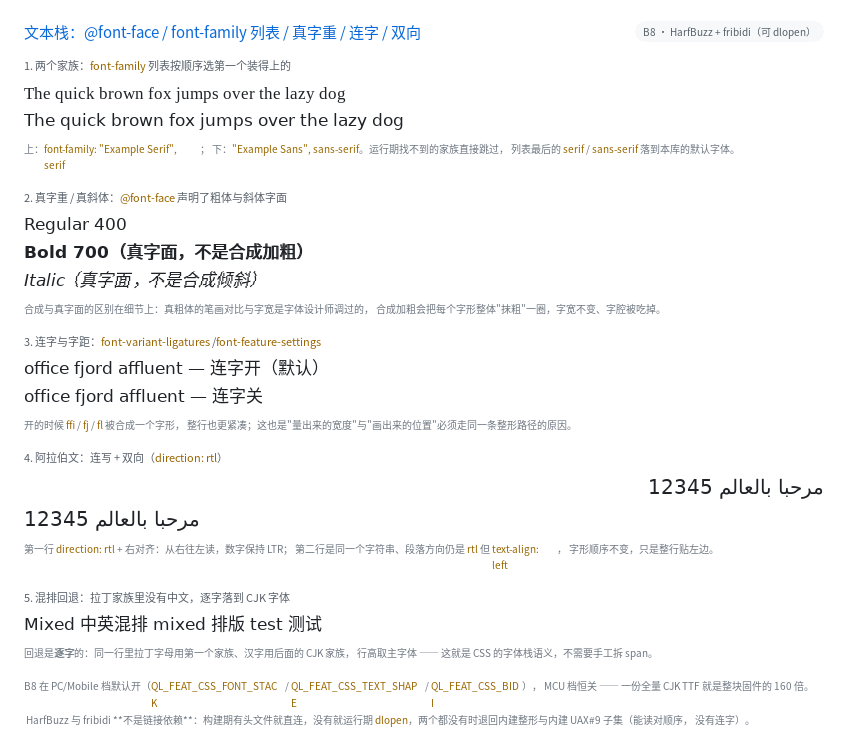

# 文本栈：`@font-face` / 家族列表 / 真字重 / 连字 / 双向



完整程序：`example/35_text_stack/`

在 B8 之前，本库只有"正文 / 等宽"两级字体，`font-weight: 700` 是把字形**抹粗一圈**、
`font-style: italic` 是把整行**剪切倾斜**，阿拉伯文会排成一串孤立形。B8 把三件事补上：

```css
@font-face { font-family: "My Sans"; src: url(/opt/fonts/MySans-Regular.ttf);
             font-weight: 400 }
@font-face { font-family: "My Sans"; src: url(/opt/fonts/MySans-Bold.ttf);
             font-weight: 700 }

body { font-family: "My Sans", "Noto Sans CJK SC", sans-serif; }
.b  { font-weight: 700; }            /* 用真粗体字面 */
.ar { direction: rtl; }              /* 阿拉伯文 / 希伯来文 */
```

---

## 1. `@font-face`：构建期只收声明

一行 `@font-face` 进 doc 里只占 8 字节（家族名、资源名都是文本池下标），**字体文件
本身不进二进制**。运行期 `ql_ui_build()` 时按这张表去注册：

- 有 `ql_font_family_register()`（或者 CSS 里直接写绝对路径）→ 打开文件；
- 打不开就**报错并跳过这条声明**（不会让整个页面编译失败）。

只认四样：`font-family` / `src: url()` / `font-weight` / `font-style`。
`unicode-range`（子集化）、`local()`（要 fontconfig）、`font-display` 都**构建期报错**。

## 2. `font-family` 是**列表**，回退是**逐字**的

```css
font-family: "My Sans", "Noto Sans CJK SC", monospace;
```

1. 第一个装得上的家族当主字体（示例里是 `My Sans`）；
2. 后面的接成回退链：拉丁字母在主字体里，汉字在主字体里没有 → 自动落到 CJK 那一节；
3. 全都装不上 → 落到 `sans-serif`（本库的默认字体）。

所以"中英混排"**不需要拆 `span`**，也不需要手工选字体。行高取主字体 —— 这跟浏览器一致。

> 实测细节：回退链的每一节是一个"包装体"，因为它不能改注册表里共享字体的
> `fallback_font`（同一张字面可能被两条不同的链用到）。

## 3. 真字重与真斜体

`@font-face` 声明了 700 和 italic 字面后，`font-weight: bold` 真的换成那份粗体文件：

| | 合成加粗 | 真粗体字面 |
|---|---|---|
| 做法 | 每个字形右移 1px 再画一遍 | 换字体文件 |
| 字宽 | 不变 | 设计师调过的 |
| 字腔（counter） | 被吃掉、糊 | 保持清晰 |

只装了一份 regular 的机器上仍然退回合成 —— 这条兜底不能删，否则粗体会"消失"。

## 4. 连字与字距：量宽度和画字形必须走同一条路

```css
.liga   { }                                  /* 默认：liga/clig 开，ffi/fj/fl 合成一个字形 */
.noliga { font-variant-ligatures: none; }    /* 关掉 */
```

断行/居中/`text-overflow` 全靠"这一行多宽"。如果**量**的时候逐码位加宽度、
**画**的时候用整形后的字形，两者会差几个像素，于是文字看起来"没对齐"。
所以 B8 把两者统一到 `ql_text_shape()`：

- 有 HarfBuzz：真正的整形（连字、字距、复杂文字）；
- 没有 HarfBuzz：逐码位 + 逐字回退，与 B8 之前**逐像素一致**。

HarfBuzz **不是链接依赖**：构建期有头文件就直连，没有就运行期 `dlopen`
（很多发行版只装运行库），两个都没有就退回内建路径。

## 5. 双向：先整形，后重排

```css
.arabic { direction: rtl; }
```

```html
<div class="arabic">مرحبا بالعالم 12345</div>
```

正确的顺序是：

```
按"字体 + 方向"切段 → 每段整形（HarfBuzz 按方向给出视觉顺序）→ 段落 RTL 时倒段
```

**先 bidi 重排文本再交给 HarfBuzz** 是错的：HarfBuzz 拿到的是一串已经反过来的字符，
它只能逐个画成孤立形，阿拉伯文就散架了（这个 bug 我们真的写下过，例程一跑就现形）。

数字要单独按 **LTR** 整形：UAX#9 里数字是"二级"，`12345` 不能变成 `54321`。

## 6. `direction: rtl` 还改对齐

`direction: rtl` 时 `text-align: start` 落在右边；显式写 `left` / `right` 仍以它为准。
`unicode-bidi` 目前按"单层"处理：`normal` / `embed` / `isolate` 同义，
`bidi-override` 记成"强制按段落方向排"。嵌套隔离与括号镜像没做。

## 7. 裁剪

| 开关 | PC / Mobile | MCU |
|---|---|---|
| `QL_FEAT_CSS_FONT_STACK` | 开 | 关（需要 FreeType，MCU 没编） |
| `QL_FEAT_CSS_TEXT_SHAPE` | 开 | 关 |
| `QL_FEAT_CSS_BIDI` | 开 | 关 |

三个开关在 MCU 上**不额外花一个字节**（实现要 FreeType / `dlopen`，硬件上没有）；
关掉之后对应属性在**构建期报错**，不会静默降级。

## 8. 排查用的环境变量

| 变量 | 作用 |
|---|---|
| `QL_TEXT_SHAPE=builtin` | 强制用内建整形（验证"没有 HarfBuzz 时像素一致"） |
| `QL_TEXT_BIDI=builtin` | 强制用内建 UAX#9 子集 |

`ql_text_shape_backend()` / `ql_text_bidi_backend()` 会告诉你当前用的是哪条实现。
