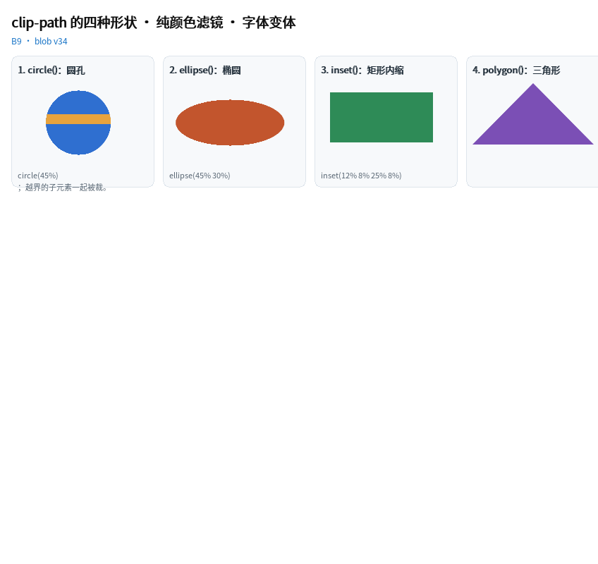

# `clip-path` 的四种形状 · 纯颜色滤镜 · 字体变体



完整程序：`example/36_clip_filter/`

这一章（B9，blob **v34**）补的都是"真实页面天天写、写了以前会报错"的东西：

```css
.avatar   { clip-path: circle(45%); }
.badge    { clip-path: polygon(50% 0, 100% 78%, 0 78%); }   /* 三角标 */
.frame    { clip-path: inset(6% 8%); }                      /* 内缩一圈 */
.oval     { clip-path: ellipse(45% 30%); }

.dim      { filter: grayscale(100%); }        /* 只是颜色 → 不进离屏图层 */
.faded    { filter: brightness(0.85) contrast(1.1); }
.big      { font-variant-caps: small-caps; }
.nums     { font-variant-numeric: tabular-nums; }
.para     { text-align: justify; white-space: normal; }
.squashed { border-radius: 40px / 12px; }     /* 椭圆圆角 */
.pop      { box-shadow: 0 0 0 8px #BFD7EF; }  /* spread */
```

它们各自的**代价**差别很大，所以下面按"便宜 → 贵"排。

---

## 1. `inset()`：最便宜，直接与裁剪矩形求交

`clip-path: inset(top right bottom left)` 是**纯矩形** —— 它等价于"把自己裁到那个
内缩矩形里"，所以实现上什么都没多做：直接把内缩矩形与当前裁剪求交，然后照原样画。

- 两个后端**都精确**（不是近似，也没有抗锯齿带的差异）；
- 零额外内存、零额外绘制遍数；
- 百分比相对**边框盒**的宽/高（与 CSS 一致：左右按宽、上下按高）。

```css
.card { clip-path: inset(12% 8% 25% 8%); }
```

值可以是 1/2/3/4 个，展开规则与 `margin` 完全一样。

---

## 2. `circle()` / `ellipse()`：解析遮罩（一条 SDF，不用缓冲）

圆与椭圆在片元里就是一个距离函数：

```glsl
d = (length((p - center) / vec2(rx, ry)) - 1.0) * min(rx, ry);
coverage = 1 - smoothstep(-0.5, 0.5, d);
```

- **GPU**：遮罩参数跟着顶点走（`a_mask = (cx, cy, rx, ry)`），一次 `glDrawArrays` 里
  每个图元各自带自己的遮罩，所以**不进离屏图层、不多 draw call**；
- **CPU**：`mask_cov_at()` 逐像素算同一个公式；填充分支还有一条"整行跨度"快路径
  （`mask_row_span`），中间那一段走 SIMD 行填充。

```css
.avatar { clip-path: circle(45%); }        /* 半径 = 最远角距离的 45% */
.oval   { clip-path: ellipse(45% 30%); }   /* rx / ry 分开 */
```

> 半径用**百分比**而不是 px 是有意的：`0% → 100%` 的动画在任何尺寸的盒子上都成立
> （px 会"提前跑完"）。见例程 `31_filter` 的揭示动画。

`circle()` 与 `ellipse()` 都裁**整棵子树**（等价 CSS 语义）：例程里那根橙色横条
故意画出父盒之外，一样被裁掉。

---

## 3. `polygon()`：解析覆盖率（零图层、零额外内存）

1. 构建期把顶点存进 **doc 的顶点池**（同样形状只存一份，一排同款徽标共用一个），
   样式里只留 `clip_pts` 下标 + `clip_pt_n`；
2. 绘制时把顶点换算成绝对坐标交给后端（`ql_draw2d_set_mask_polygon`），
   覆盖率 = **奇偶内点判定 + 到最近边的距离**，再走 ±0.5px 的 smoothstep 抗锯齿；
3. CPU 逐像素算（`qlcanvas.c` 的 `poly_cov`），GPU 在片元着色器里用 uniform
   顶点表算（`u_pn` / `u_p[N]`），两边逐字对应。

所以边的清晰度**与元素尺寸无关**，也没有 64×64 蒙版图 + 离屏图层那种开销：
一张 800px 宽的三角形和 80px 宽的三角形，边上都只有 1px 左右的过渡带。

约束（构建期报错，不做静默降级）：

| 写法 | 结果 |
|---|---|
| `polygon(0 0, 100% 0, 50% 100%)` | ✅ 至少 3 个顶点，任意多个（上限 `QL_CFG_UI_CLIP_PTS_MAX`） |
| `polygon(... , evenodd)` | ❌ 本库形状只有一层，evenodd 与非零环绕结果相同 —— 报错以免你以为生效了 |
| `path('M0 0 L…')` / `url(#id)` | ❌ 要 SVG 路径解析器，明确不支持 |
| `inset(… round 4px)` | ❌ 圆角矩形裁剪要另一套扫线；建议改用 `border-radius` + `overflow: hidden` |
| `circle(50% at 30% 30%)` | ❌ 圆心恒在元素中心 |

---

## 4. 纯颜色 `filter`：**不进离屏图层**

在 B9 之前，任何 `filter` 都会让这一层走离屏图层（先把子树合成一张 RGBA，再整体处理）。
但 `brightness()` / `contrast()` / `saturate()` / `grayscale()` / `sepia()` /
`invert()` / `hue-rotate()` / `opacity()` 这八个只改**颜色**，逐图元做和先合成再做
在绝大多数用法里没有区别 —— 而它们的代价差一整块缓冲 + 两遍绘制。

所以现在构建期把这一串函数**折成一个 3×4 颜色矩阵**（16.16 定点，链式相乘）：

- **CPU**：挂到 `QLCanvas` 上，`put_px` / 行填充 / `blit_image` 三个入口过一遍矩阵
  （开启时绕开 SIMD 行填充，因为那条路不经过逐像素）；
- **GPU**：作为 uniform 上传（`u_cm[3]` + `u_cm_on`），片元里在**唯一出口**处施加 ——
  这样不会重演当年"圆遮罩漏了某个 return"的老坑。

`QLQ` 侧只是判断"这一串 op 里有没有 blur / drop-shadow"：

```c
if (s->filter_n > 0) {
    int32_t m[12], apm = 1000;
    if (!filter_build_cm(s, m, &apm))
        return 1;      /* 含 blur / drop-shadow → 老老实实走图层 */
}
```

> **语义差别（写进文档，不藏着）**：CSS 的 `filter` 作用于"元素合成后的结果"，
> 逐图元施加时，**子树内部互相重叠**的地方会略有不同。`filter: brightness(.9)`
> 这类用法看不出区别；要严格等价就加一个 `blur()`（或 `blur(0.001px)`）把它推回图层。

`opacity()` 在这里被折成"乘进 `d2d->alpha`"，所以它也不需要图层。

---

## 5. 字体变体：`small-caps` / `tabular-nums`

这两个都靠 **OpenType 特性**（`smcp` / `tnum`），所以需要 HarfBuzz：

```css
.title { font-variant-caps: small-caps; }
.nums  { font-variant-numeric: tabular-nums; }
```

- 有 HarfBuzz → 给 `hb_shape()` 多挂两条 `hb_feature_t`；
- 没有 HarfBuzz → **构建期报错**（`QL_FEAT_CSS_TEXT_SHAPE=0` 时）。
  不做"看起来生效了其实没变"的静默降级 —— 那比报错更难查。

样式里只占**一个字节**（`variant_flags` 位图），所以 MCU 上开关它没有成本。

---

## 6. 顺手补上的几件小事

| 属性 | 行为 | 说明 |
|---|---|---|
| `text-align: justify` | 除**最后一行**外，把剩余空间平摊到字形间隙 | 只有一行时等于左对齐；`text-overflow: ellipsis` 的行不拉伸 |
| `border-radius: a / b` | 水平半径 `a`、垂直半径 `b` | 绘制侧取两者**平均**作为等价单半径（精确椭圆角要改两个 SDF，见文档 §5） |
| `box-shadow: x y blur spread color` | 第四个长度 = 扩散半径 | 阴影轮廓整体外扩/内缩，与浏览器一致（spread 作用于"形状"，不是模糊） |
| `font: italic bold 20px/28px monospace` | 简写 | 支持 style / variant / weight / size / line-height / family |
| `word-wrap: break-word` | = `overflow-wrap` 的老名字 | |
| `:empty` | 没有子元素、也没有非空文本 | **只有空白**的元素算 empty（它不产生盒子），与 CSS 一致 |
| `revert` | 与 `unset` 同路径 | 回滚到"父级继承值 / 初始值" |
| `::first-line` / `::first-letter` | **构建期报错** | 哪几个字落在第一行要等布局才知道，而本库样式是构建期编译成静态表的；请用 `<span class=...>` 手工包住那几个字 |

---

## 7. 三个"顺手抓到"的真 bug

这一轮改动同时暴露了三处老问题（都已修，并被 `test_b9` / 全量用例守住）：

1. **GL 片元的零半径遮罩**：`min(rx, ry) == 0` 时距离被乘成 0，`smoothstep` 得 0.5，
   整块变半透明 —— golden 的 `clip` 用例 CPU/GPU 差 47%。（现在半径 ≤ 0 明确判为全裁。）
2. **column flex 里的折行文本高度**：折行基准用的是**容器**宽度而不是**子项自己**的
   `width`，于是"窄列 + 长段落"被算成 1 行（高度 20px），而绘制按 440px 折成 2 行，
   第二行压到下一个元素上。
3. **行内子节点的测量高度**：column 布局里把 `inline` 子节点的高度**逐个相加**了
   （`<span>a</span><span>b</span>` 得 84px 而不是 23px）。现在按"行内一行取最大值"算。

---

## 8. 裁剪开关与 MCU

| 能力 | 开关 | 关掉之后 |
|---|---|---|
| `clip-path` 四种形状 | `QL_FEAT_CSS_FILTER_LAYER`（`polygon` 依赖图层；`circle`/`ellipse`/`inset` 只依赖 SDF 与裁剪） | 写 `clip-path` 构建期报错 |
| 纯颜色 `filter` | 同上 | 同上 |
| `small-caps` / `tabular-nums` | `QL_FEAT_CSS_TEXT_SHAPE` | 构建期报错（没有整形就没有特性表） |

用 `qltext check --platform mcu` 可以在**构建前**知道这份界面在 MCU 上会被裁掉哪些东西
（见《QLUI API 手册》的 `qltext` 一节）。
