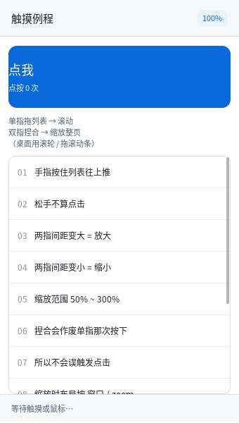

# 触摸：单指点按 · 拖动滚动 · 双指缩放



完整程序：`example/37_touch/`

手机上只有触摸：**没有滚轮、没有 hover、没有"精确到像素"的指针**。这一章讲清楚
触摸是怎么从协议走到界面的，以及三件必须做对的事。

```c
/* 后端只管上报：哪根手指、在哪儿、手上还有几根 */
ql_input_push_touch(x, y, QL_TOUCH_DOWN, /*id=*/0, /*count=*/1);

/* 界面层认手势，接一个回调就能收到捏合 */
ql_ui_set_pinch_cb(ui, on_pinch, NULL);

/* 捏合 → 整页缩放：布局按 窗口/zoom，绘制由后端放大 */
ql_gfx_gl_set_zoom(gfx, zoom_fx);
ql_ui_layout(ui, win_w * QL_SCALE_ONE / zoom_fx, win_h * QL_SCALE_ONE / zoom_fx);
```

---

## 1. 分工：后端不上报鼠标，手势在界面层认

Wayland 的 `wl_touch` 给的是"每根手指一串 down/move/up"。最省事的做法是每根手指
都合成鼠标事件 —— 但那样**双指就是两次乱点**，而且"这一下算点按还是算拖动"
根本没法判断（要看按在谁身上）。

所以分工是：

| 层 | 只做 | 不做 |
|---|---|---|
| 后端（`qlwindow_wayland.h`） | 把 `wl_touch` 翻成 `QL_INPUT_TOUCH`，数清"手上还有几根" | 不合成指针事件、不认手势 |
| 输入队列（`qlinput.c`） | 排队、派发 | 不知道界面长什么样（老规矩） |
| 界面层（`qlui.c`） | 单指=鼠标、拖动=滚列表、双指=捏合 | 不碰协议 |

这正是本库一贯的分法（见 `QLUI 阅读指南` 的"命中测试在界面层"），好处是**触摸逻辑
可以在没有触摸屏的机器上测**：`test_touch` 就是直接喂合成事件的。

## 2. 单指：先当鼠标，超过 8px 就改主意

```c
QL_CFG_UI_TOUCH_SLOP   /* 8px：手指抖 2~3px 很常见，不设阈值会把点按都认成拖动 */
```

- 按下 → `ql_ui_pointer_down()`（`:active` 样式、输入框定位、按钮按下效果全都免费得到）；
- 移动但没超过 8px → 只更新位置（**不算拖动**）；
- 一旦超过 8px → 记下"按在哪个可滚动容器上"，之后每次移动都按
  **"按下点 + 累计位移"** 算目标滚动位置（而不是每帧加增量 —— 中途被夹到头也不会积累误差）；
- 抬起：拖过就不合成 `click`，没拖过才合成。

> 用累计位移而不是增量，是"手指按住不放慢慢挪"能稳定停住的原因；增量式实现在
> 滚到边界再往回拖时会少走一截。

## 3. 双指：先把刚才那次按下作废

第二根手指落下时，第一根手指的"按下"已经发生过了（按钮可能已经变色）。这时必须：

1. `press_abort()`：清掉 `:active` / 拖动选字 / 滚动条拖动状态；
2. **不**合成 `click`；
3. 记下两指间距作为基准，回调 `QL_UI_PINCH_BEGIN`；
4. 之后每次移动回调 `QL_UI_PINCH_UPDATE`，倍数 = **当前间距 / 基准间距**。

手势结束时（抬起一根）回调 `QL_UI_PINCH_END`，并且**剩下的那根手指不再当鼠标** ——
否则"两指缩放完，先松开一根、另一根还按着"，最后那一下抬手会在落点误触发一次点击。

倍数用"相对基准"而不是"相对上一帧"：手指抖动时增量会累积漂移，一两秒下来画面就歪了。

## 4. 缩放整页：布局基准变小，绘制变大

库只给"倍数"，缩放什么由应用决定（可能只想缩放一张图）。例程缩放整页，做两件事：

```c
ql_gfx_gl_set_zoom(gfx, zoom);                      /* 绘制时 CSS px 乘 zoom */
ql_ui_layout(ui, win_w * QL_SCALE_ONE / zoom,       /* 布局基准 = 窗口 / zoom */
                 win_h * QL_SCALE_ONE / zoom);
```

为什么不是"改字号"或"改宽度"：那两样都要重新解析 CSS、重新算 em/rem，而且
**文字会重排**（行数变、换行位置变）。按 DPR 的方式放大是纯几何的：布局在
`窗口/zoom` 的空间里照旧，绘制时整体乘一个系数，字形还按新尺寸重新取字体
（所以放大后是清晰的，不是位图拉伸）。

| 概念 | 决定什么 | 谁改 |
|---|---|---|
| `scale_fx`（DPR） | **帧缓冲多大**（设备像素 = CSS × DPR） | 后端（`wl_output.scale`） |
| `zoom_fx`（应用缩放） | **同样的缓冲里内容画多大** | 应用（捏合/`Ctrl+滚轮`） |

输入坐标不用应用操心：X11 后端按 `设备像素 / (DPR×zoom)` 换算，Wayland 外壳按
`逻辑坐标 / zoom` 换算 —— 界面层拿到的永远是它自己那套 CSS 坐标。

```c
./build/example/example_37_touch              # 触摸屏：直接上手
./build/example/example_37_touch --zoom 150   # 没触摸屏时验证缩放路径
```

## 5. 顺手修掉的一个真 bug：flex 里的滚动容器滚不动

写这个例程时发现的：手机布局几乎都是

```css
.body { display: flex; flex-direction: column; }
.list { flex: 1 1 0; overflow-y: auto; }     /* 中间那块列表 */
```

结果列表**怎么滚都回到顶部**。原因是 flex 要**先测量**每一项的主轴尺寸，
测量那几轮会真的跑一遍布局 —— 那时容器高度还是临时值（实测列表一轮 540、
一轮 538、最后才 336），而 `apply_scroll()` 会把滚动偏移夹进"本轮算出来的
可滚范围"里：540 高的那轮范围是 0，用户的滚动位置就被夹成 0 了。

修法是给测量加个开关（`layout_measure()` → `s_measuring`），测量期间
`apply_scroll()` 直接返回，不动运行期状态。回归测试在 `test_scroll` 第 11 节：

```c
ql_ui_scroll_by(ui, sc, 0, 60);   /* 滚到 60 */
ql_ui_layout(ui, W, H);           /* 再排一次（每帧都会做的事） */
CHECK(sc->scroll_y == 60);        /* 位置必须还在 */
```

## 6. 已知不做

- **多指手势的识别（三指滑动、旋转）**：五根手指的状态都上报了，但库只认单指拖动
  和双指捏合这两件。旋转要 `atan2` 和角度归一化，本机也没法好好验证；
- **惯性滚动（fling）**：松手后继续滑一段。要速度采样 + 衰减动画，属于"手感"而不是
  "能不能用"，先不做；
- **长按 / 双击**：`QLInputEvent.time_ms` 字段留着，但没接；
- **原生 Wayland 的软键盘**：要 `zwp_text_input_v3` / `zwp_input_method_v2`，
  见 `开发规划` M6.5 第 4 步（触摸有了、弹不出键盘的手机还是不完整）。
