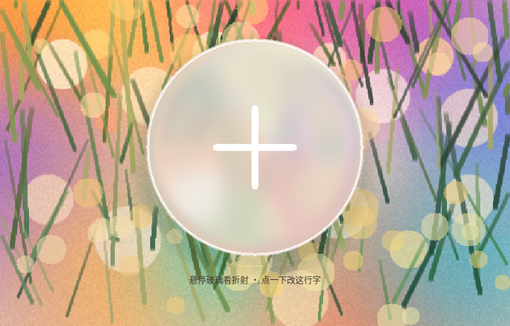

# 液态玻璃：`blur` + `refract` 的玻璃圆盘



完整程序：`example/38_liquid_glass/`（对照稿：codepen.io/Mikhail-Bespalov/pen/MYwrMNy）

> 直接看效果（背景是**你给的图片**，不再由程序生成）：
>
> ```bash
> ./build/example/example_38_liquid_glass --image ~/Pictures/watercolor.jpg
> ```
>
> - **滚轮**：上下滚动背景照片（玻璃固定在中间，所以同一块玻璃会折过照片的不同部分）
> - **悬停**圆盘：折射半径 143px → 200px（0.22s 插值过去），同时整体放大 2%、白底变亮
> - **点一下**圆盘：下面那行字换一次

---

## 1. 参考稿的全部秘密就四个数值

| # | 数值 | 作用 |
|---|---|---|
| ① | `background-color: rgba(255,255,255,.08)` | 玻璃本身几乎不挡光 —— **这一个 alpha 决定"透不透"** |
| ② | `box-shadow: 0 0 3px 1px rgba(255,255,255,.55)` | 一圈柔和的亮边（参考稿是 2px 硬环，深色照片上太刺眼） |
| ③ | `box-shadow: 0 16px 32px rgba(0,0,0,.12)` | 很淡的投影，玻璃于是"浮"在背景上 |
| ④ | `backdrop-filter: blur(6px) refract(143px)` | 毛面 + **整块厚透镜折射** |

```css
.glass {
  background-color: rgba(255, 255, 255, 0.08);
  box-shadow: 0 0 3px 1px rgba(255, 255, 255, 0.55),
              0 16px 32px rgba(0, 0, 0, 0.12);
  backdrop-filter: blur(6px) refract(143px);
  transition: background-color 220ms ease-out, transform 220ms ease-out,
              backdrop-filter 220ms ease-out;
}
```

> ① 是最容易写错的地方：alpha 拉到 0.2 以上立刻变成"白塑料"，0.08 才是玻璃。
>
> **不要写 `border: 2px solid transparent`**：本库的 `border-color` 没有 alpha 通道
> （`QLUIStyle.border_color4` 是 `0xRRGGBB`），透明会被当成纯白 —— 看起来就是一圈
> 很突兀的白边。亮边请用 `box-shadow`。

## 2. `refract()`：参考稿里那个 `feDisplacementMap`

参考稿的滤镜链是 **`feGaussianBlur` + `feDisplacementMap`**：先轻度模糊，再按一张
200×200 的**法线图**把像素**位移**。把那张图解出来实测：R/G 通道编码的是一个
**朝圆心**的位移场

```
位移 = 0.5 - 单位径向 × f(t)      t = 归一化半径（0 圆心、1 轮廓）
实测 f(1) ≈ 0.476 → 轮廓处的最大位移 ≈ 0.48 × 盒子尺寸
```

也就是说：位移**朝圆心**，随半径增长，轮廓处最大 —— 边缘那一圈显示的是内部画面被
压扁后的结果，像一块厚透镜。本库用 `0.46·t + 0.54·t⁶` 拟合这条曲线（最大误差 ≈ 0.016）：

| 参考稿 | 本库 |
|---|---|
| `feGaussianBlur stdDeviation≈0.02`（objectBoundingBox） | `blur(<N>px)`（320px 盒子 ≈ 6.4px） |
| `feDisplacementMap`（法线图，朝圆心） | `refract(<N>px)`（同一方向、同一条径向曲线） |

**`refract(N)` 的语义**：圆心处不动，越靠外位移越大，轮廓处最多 **N px**，方向朝圆心。

- 半径怎么选：**≈ 0.48 × 盒子尺寸**。例程的圆盘 300px，取 143px；悬停时 200px（1.4×）。
- 只写 `refract()` 也可以 —— 那就是一块干净的放大镜；只写 `blur()` 就是普通毛玻璃。
  两者一起写才是"液态"。
- 函数任意顺序、可以只写其中一部分；写其它函数（`brightness()` 等）**构建期报错**。
- 上限 255px（`backdrop_refract` 是 8 位字段）。

## 3. 悬停：`backdrop-filter` 也是可过渡属性

折射半径是"玻璃变厚"的唯一来源，不插值的话鼠标一放上去整块玻璃会瞬间跳一下。
所以 `transition` 里要写 `backdrop-filter`（本库会同时插值 `blur` / `saturate` /
`refract` 三个参数）：

```css
transition: background-color 220ms ease-out, transform 220ms ease-out,
            backdrop-filter 220ms ease-out;
```

注意本库的 `transition` **只支持一组时长/缓动**（`trans_ms` / `trans_ease` 只有一份），
三段写不同时长会在构建期报错。回归测试：`test_transition_backdrop`。

## 4. 为什么 `blur()` 只有 6px

模糊的目的是"看不清细节"，不是"看不见东西"。半径一大，背景就被糊成一团均值色，
玻璃立刻变灰塑料。参考稿的 `stdDeviation="0.02"` 在 320px 的圆盘上就是 6.4px，这里取 6px。

**厚度感来自 `refract()`，不是来自模糊半径。**

## 5. 背景照片：`--image` + 滚轮滚动

背景不再由程序生成（旧版本用 LCG 画了一张水彩图）。现在：

```bash
./example_38_liquid_glass --image photo.jpg
./example_38_liquid_glass --image photo.png --size 900x600
./example_38_liquid_glass --image photo.jpg --scroll 250 --dump /tmp/g.ppm
```

- 运行期解码（PNG / BMP / QOI；构建带 libjpeg 后端时也支持 JPEG），
  注册成资源名 `photo`，对应 ``；
- **高分辨率壁纸直接支持**：解码时临时放开像素预算
  （`ql_image_set_decode_budget(256MB)`），解完按窗口需要的尺寸做一次
  box-filter 降采样（宽 ≤ 2×窗口、夹在 1280~2048，总像素 ≤ 6M），
  只保留显示用的那份像素。2700×4800 的手机壁纸 → 1440×2560；
- 输入文件上限 32MB（`QL_CFG_IMAGE_MAX_ENCODED_BYTES`），像素上限
  `QL_CFG_IMAGE_MAX_PIXELS`（默认 4096×4096）；
- 照片显示得比窗口高（`__PHOTO_H__` 由 `main.c` 按图片比例替换成具体 px，
  且至少 1.6×窗口高），放在 `overflow-y: scroll` 的容器里；
- 滚轮由例程自己的**事件过滤器**接住，直接对容器调用 `ql_ui_scroll_by()`：
  玻璃/舞台铺满整屏，命中链里没有可滚动祖先，靠界面层自己的命中测试滚不到照片。

没有 `--image` 时程序会打印用法退出；也可以把图片放到例程目录、命名
`background.png` / `background.jpg` 作为默认背景。

## 6. 实现上必须做对的三件事

1. **模糊的采样范围要比盒子大一圈**（按 `3·σ`）。模糊核本来就要读盒子外面：
   只糊盒内、边缘靠钳位补的话，得到的是"这块方形的均值色"，半径一大就发灰，
   四边还会留一圈方形的边。折射朝圆心采样、不读盒子外面，不需要为它外扩。
2. **结果只写进轮廓之内**（按圆角覆盖率与原像素混合），轮廓外一个像素都不动 ——
   否则四个圆角缺口里会渗出"方的模糊块"。
3. **三段盒式卷积近似高斯**。两段是三角核，边缘有一道可见的折线；三段才接近钟形。

CPU 与 GL 两个后端走同一套参数与顺序，`test_gl_vs_cpu` 对着色器做逐像素对拍。

## 7. 限制（都是明确报错，不静默降级）

| 限制 | 说明 |
|---|---|
| 函数集合 | 只有 `blur()` / `saturate()` / `refract()`，其它函数构建期报错 |
| `refract` 上限 | 0~255px（`backdrop_refract` 是 8 位字段） |
| 边框 alpha | `border-color` 没有 alpha 通道：`transparent` 会被画成实色，半透明亮边请用 `box-shadow` |
| 过渡时长 | `transition` 各段必须共用同一组时长/缓动 |
| 平台档 | 属于 `QL_FEAT_CSS_BLUR`（PC 档特性）；MCU 档恒关 |
| 层数 | 玻璃套玻璃天然可用（先采样"已画好的内容"，再画自己），但每多一层就多一次模糊 |

## 8. 性能（本机 720×460、GL 后端、240 帧）

| 项 | 数值 |
|---|---|
| 帧时间 p50 / p95 | **16.62 ms** / 17.68 ms |
| 其中等 swap | 16.33 ms（几乎全是等垂直同步） |
| 实际渲染 | 约 **0.3 ms** |

一帧的预算几乎全花在 vsync 上，真正画一张"照片 + 折射玻璃"只要零点几毫秒。
成本主要随**玻璃元素数量**线性增长（每块玻璃一次模糊 + 一次折射位移）。

## 9. 写玻璃时踩过的坑（都已修 / 都已记录）

### 9.1 渐变的两个色标共用一个 alpha（**已修**）

以前一个背景只有**一个** alpha：`rgba()` 写在渐变色标里会被忽略，于是"上亮下透"
的玻璃做不出来。现在两个色标各带自己的 alpha，插值时"颜色 + alpha"一起插。
兼容规则：两个色标都不写 alpha 时沿用 `background-color` 的 alpha。

### 9.2 `box-shadow: inset` + 圆角=半边长 → 四角被涂满（**已修**）

正圆/药丸的圆角正好等于半边长，矩形四角落在轮廓**外面**，而内阴影的覆盖率公式
在那一片恒等于 1 —— 四个角被整片涂成阴影色，看着像"圆外面套了个方框"。
修法是片元里再乘一个"在轮廓内"的覆盖率；回归测试在 `test_gl_vs_cpu`。

### 9.3 `transition` 的可过渡属性

`background-color` / `opacity` / `color` / `border-color` / `border-radius` /
`transform` / `clip-path` / `backdrop-filter`。写别的会在**构建期报错**（不静默忽略）。
