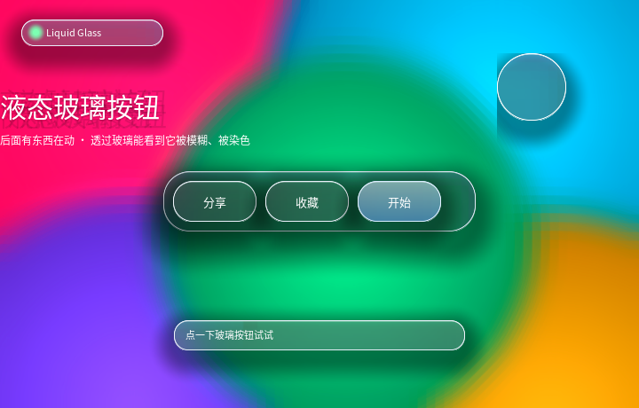

# 液态玻璃：`backdrop-filter` 的玻璃按钮 + 背后会动的东西



完整程序：`example/38_liquid_glass/`

> 想直接看效果：`./build/example/example_38_liquid_glass`。
> 按住按钮会看到它变亮（`:active`），右上角那个玻璃气球会自己走，
> 走到哪儿就把哪儿的背景吃掉一块做成模糊。

---

## 1. 玻璃 = 三层，少一层就变"灰色塑料"

| 层 | 实现 | 作用 |
|---|---|---|
| ① 背后模糊 + 染色 | `backdrop-filter: blur(40px)` + `background-color: rgba(...,0.1~0.2)` | 玻璃"透过去"的那部分 |
| ② 亮边 + 内高光 | `border: 1px solid #FFFFFF` + `box-shadow: inset 0 1px 0 rgba(255,255,255,.55)` | 玻璃的**厚度**感 |
| ③ 投影 | `box-shadow: 0 10px 30px rgba(0,0,0,.38)` | 玻璃**浮在**背景上 |

只做 ① 会得到一块"灰蒙蒙的毛玻璃"；②③ 才是让人认出"这是玻璃"的东西。
这三样都是纯绘制，不增加模糊次数。

```css
.head, .dock, .btn, .puck {
  backdrop-filter: blur(40px);
  background-color: rgba(226, 236, 255, 0.12);
  background-image: linear-gradient(180deg, #FFFFFF, #DCE8F8);
  border-width: 1px;
  border-style: solid;
  border-color: #E9EFF9;
  box-shadow: inset 0px 1px 0px rgba(255, 255, 255, 0.55),
              0px 10px 30px rgba(0, 0, 0, 0.38);
}
```

## 2. 背后的"东西"：整层一次模糊

五个 400~520px 的色块互相重叠、各自 `transform: translate()` 动画（零重排），
外面套一层 `filter: blur() saturate()`：

```css
.scene {
  filter: blur(20px) saturate(150%);   /* 一个离屏图层，**不是**五个 */
}
```

> 给每个色块各加一次 `filter` 会让图层数乘 5。容器上一次就够，
> 因为 `filter` 是对"合成后的结果"生效 —— 这也是 CSS 的语义。

色块要**大且重叠**，保证任何位置的玻璃后面都有颜色。玻璃最容易翻车的场景是
"底下是深色空白"——那看起来就是一块灰塑料。

## 3. 这个例程逼出来的三个真 bug / 限制

写的时候一路"看着不对就查"，查到三件事，两件已经修进库里：

### 3.1 渐变的两个色标共用一个 alpha（限制，未改）

```css
background-color: rgba(226, 236, 255, 0.12);        /* ← 透不透由它决定 */
background-image: linear-gradient(180deg, #FFFFFF, #DCE8F8);  /* ← 只做明暗 */
```

本库一个背景只有**一个** alpha：`rgba()` 写在渐变色标里会被忽略。所以"上亮下透"
的渐变（玻璃最常用的那种）做不出来，只能"整体 alpha + 明暗层次"。
要真做得更细，需要给渐变的每个色标单独存 alpha。

另外渐变目前只支持**两个**色标、只支持水平/垂直方向、`radial-gradient` 只支持圆心在中心。

### 3.2 `box-shadow: inset` + 圆角=半边长 → 四角被涂满（**已修**）

玻璃按钮/气球都是"药丸"或正圆，也就是 `border-radius` 正好等于半边长。
这种形状下 SDF 是圆角轮廓的，矩形四角落在轮廓**外面**，而内阴影的覆盖率公式
在那一片恒等于 1 —— 于是四个角被整片涂成阴影色，看起来像"圆外面套了个方框"。

CPU 侧的 `ql_canvas_fill_inset_shadow()` 用 `round_row_span()` 限定在轮廓内，所以
**只有 GPU 有这个问题**，而且离屏对拍没覆盖到（当时没有圆角 + 内阴影的用例）。

修法是片元里再乘一个"在轮廓内"的覆盖率：

```glsl
float cov = 1.0 - smoothstep(0.0, max(border, 1.0), -d);
cov *= 1.0 - smoothstep(-0.5, 0.5, d);      /* ← 新增 */
```

回归测试加在 `test_gl_vs_cpu`（"box-shadow: inset + 正圆 / 药丸"两例）：
改回去立刻报 `差异 2.07%`。

### 3.3 `transition` 只认这七个属性

```css
transition: background-color 180ms ease-out, border-color 180ms ease-out;
```

按下时**只改** `background-color` / `border-color`，不改 `background-image` ——
后者不在可过渡列表里，写了会在**构建期报错**（本库的原则是不静默忽略）。

可过渡属性：`background-color` / `opacity` / `color` / `border-color` /
`border-radius` / `transform` / `clip-path`。

## 4. 玻璃叠玻璃

按钮坐在玻璃"托盘"上（`.dock` 里放 `.btn`）。这是最容易出问题的地方：
后画的元素模糊的必须是"**已经画好**的背景"，包括托盘自己。

本库的实现顺序天然满足这一点（`backdrop-filter` 在画自己背景**之前**采样），
所以玻璃套玻璃直接就能用，不需要额外处理。

## 5. 性能

| 项 | 数值（本机 1920×1080、GPU 后端） |
|---|---|
| 帧时间 p50 | **6.93 ms**（≈144 fps，跟 vsync） |
| 其中等 swap | 6.64 ms（几乎全是等垂直同步） |
| 实际渲染 | 约 0.3 ms |

代价主要在**模糊次数**：5 个玻璃元素各一次 backdrop 模糊 + 场景一次
`filter` 模糊。想更快就减少玻璃元素数量或降低 `blur()` 半径
（半径直接决定降采样的盒半径）。

CPU 后端（`--dump`）也能跑，画面基本一致，只是模糊是逐像素盒式近似、边缘略硬。
